# RumiCar Zero2Cam

**English** | [日本語](README.md)

Software for the RumiCar built around a Raspberry Pi Zero 2 W and a Camera Module 2.
One repository holds the car side (C++), the PC drive manager (C# / .NET 10), the wire formats between them, the distribution formats, and the automated builds.

- Usage (from writing the SD card to driving, recording, and updating the decision data): the [How to use](#how-to-use) section below
- Specification (settings, wire formats, distribution formats, builds): [docs/RumiCar-Zero2Cam 仕様書.docx](docs/RumiCar-Zero2Cam%20仕様書.docx) (Japanese)
- Design record (investigations, options compared, rationale for decisions, design and implementation history of the image logic; reference material for learning): [docs/RumiCar-Zero2Cam 設計の記録.docx](docs/RumiCar-Zero2Cam%20設計の記録.docx) (Japanese)
- Downloads: [Releases](https://github.com/RumiCar-group/RumiCar-Zero2Cam/releases)

## Layout

| Directory | Contents |
|---|---|
| `car/` | Car side: `rumicar-core` (control loop, hardware control, networking, hot-swap mechanism), the driving logics `tof_drive`, `cam_drive` and `py_drive` (shared libraries; `py_drive` executes a Python program written by the user), the bundled packs `base-tof`, `cam-base` and `py-sample`, the learning and replay tools, unit tests, Debian package and SD-card image builds |
| `pc/` | PC side: `RumiCar.Protocol` (wire formats, manifests, recording), `RumiCar.Protocol.Tests`, `RumiCar.DriveManager` (WPF drive manager) |
| `docs/` | The specification and the design record (both .docx, in Japanese; published for educational use), the figure sources (`docs/figures`, Mermaid, Japanese and English) |
| `.github/workflows/` | CI (`car.yml`: Debian 13 arm64/amd64 and the SD-card image, `pc.yml`: Windows, `release.yml`: releases from tags) |

**Figure 1** System overview (car, PC, Claude desktop app)

<!-- figure: en/01-system.mmd -->
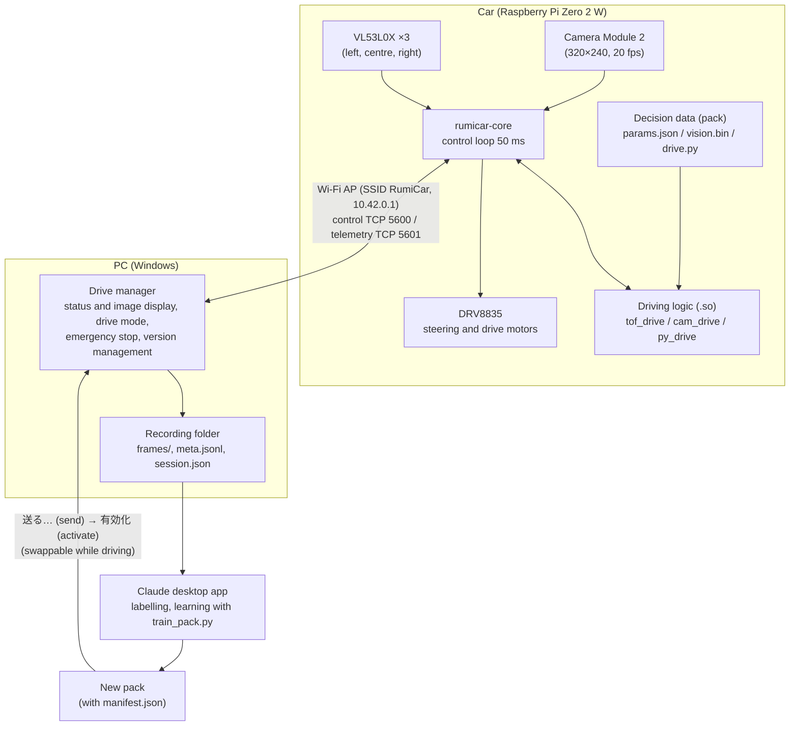

---

# How to use

## 1. Required equipment

| Item | Notes |
|---|---|
| A RumiCar chassis with a Raspberry Pi Zero 2 W | DRV8835 motor driver, three VL53L0X distance sensors (left, centre, right), Camera Module 2. Wiring identical to the existing RumiCar (spec 3.4) |
| microSD card | 8 GB or more (Class 10 / A1 recommended) |
| Windows PC (64-bit, Windows 10/11) | Wi-Fi required; runs the drive manager |
| SD-card writer | [Raspberry Pi Imager](https://www.raspberrypi.com/software/) |

The car **does not start driving on power-on**: it boots into record-only mode (motors braked) and starts driving when **「自動」** (auto) is selected in the drive manager (since v0.1.3; earlier versions started driving at power-on). To start driving at power-on without a PC, set `startup_mode` to `auto` in `/etc/rumicar/core.json` (section 8). For the first boot and for checks, place the car on a stand so that the wheels do not touch the floor.

## 2. Writing the SD card

1. From the latest [Release](https://github.com/RumiCar-group/RumiCar-Zero2Cam/releases) download:
   - `rumicar-zero2cam-<version>-<date>.img.xz` — the car's SD-card image (about 620 MB)
   - `RumiCarDriveManager-<version>-win-x64.zip` — the PC drive manager
2. Start Raspberry Pi Imager. **Device**: Raspberry Pi Zero 2 W. **OS**: "Use custom" (at the bottom of the list), then select the downloaded `.img.xz`. **Storage**: the SD card.
3. Press Next. To "Would you like to apply OS customisation settings?" answer **No**. User, SSH, Wi-Fi and hostname are preconfigured in the image; configuring Wi-Fi here conflicts with the image's configuration (the car operates as an access point).
4. When writing is complete, insert the card into the car.

Optional verification of the download: the values in the Release's `SHA256SUMS.txt` must match the output of `Get-FileHash <file>` in PowerShell.

## 3. First boot

1. Place the car on a stand and switch it on.
2. The first boot expands the partition and reboots once automatically. Wait 2–3 minutes.
3. `rumicar-core` then initialises the sensors → starts the Wi-Fi access point → starts the camera (after a PC connects), in this order. Functions with high current consumption are not started simultaneously, to avoid voltage drops on dry-cell batteries (section 10). **The car does not drive at this point** (record only); connect as in section 4 and select 「自動」.

**Figure 2** Start-up sequence (high-current functions started one after another)

<!-- figure: en/02-startup.mmd -->
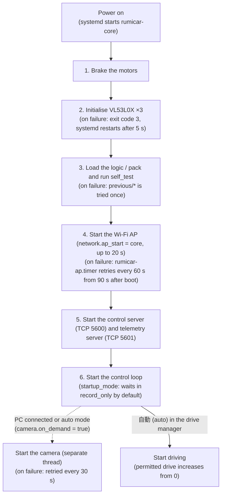

Image defaults:

| Item | Value |
|---|---|
| Wi-Fi access point | SSID `RumiCar`, no encryption (the image is public; accepted for educational use) |
| Car IP address | `10.42.0.1` (the PC is assigned `10.42.0.x` by DHCP) |
| Login | user `rumicar`, password `rumicar`, SSH enabled, hostname `rumicar` |
| Wireless regulatory country | JP (required for access-point operation) |

## 4. Connecting from the PC

1. Connect the PC's Wi-Fi to `RumiCar` (no password; connect even if Windows reports the network as not secure).
2. Extract `RumiCarDriveManager-<version>-win-x64.zip` and run `RumiCarDriveManager.exe` (no installation required).
   - If "Windows protected your PC" (SmartScreen) appears the first time, choose "More info" → "Run anyway". The executable is not code-signed.
   - If Windows Defender Firewall prompts, choose "Allow access".
3. Leave "車両" (car) at `10.42.0.1` and press **「接続」** (Connect). The connection is established when `車両 RumiCar, 本体 <version>` is logged and the status panel shows the ToF values, the logic state and the camera image.
4. To drive, press **「自動」** (auto) under 走行モード. For a first drive, or before the behaviour of the car and course is known, **set 「自動の最大出力」 (auto limit) to 30–50 % beforehand** (the recommended value as of v0.3.0; raise it while checking the behaviour; section 5).

The drive manager's user interface is in Japanese; the table below gives the meaning of each part.

## 5. The drive manager

| Part | Meaning |
|---|---|
| 車両 / 名前 | Car IP address (default `10.42.0.1`) and the car name used in recording folder names (default `RumiCar`) |
| 非常停止 / 非常停止解除 | Emergency stop / clear. The e-stop brakes in every drive mode, and the car does not drive until it is cleared. It is also latched automatically when, in manual mode, the heartbeat is lost for 1 s (`network.heartbeat_timeout_ms`) or the PC disconnects |
| Image | Latest camera image (320×240, about 20 frames/s). Unticking 「画像を表示」 stops only the display (reception and recording continue; use it to reduce the PC load) |
| 状態 (status) | モード = drive mode; 非常停止 = e-stop (green = none, red = active, with reason); 判断状態 = logic state (CRUISE / TURN_LEFT / TURN_RIGHT / EMERGENCY_BRAKE / RECOVER_REVERSE / SENSOR_FAULT, etc.); ToF 左/中/右 = left/centre/right distance [mm] (see the table below); モーター出力 = motor output; ロジックの判断 = logic decision; 版 = logic / pack versions; **判断データ** = the active pack's name, version and description; **対応機能** = supported scenes (壁 walls / 信号機 traffic light / 車両 vehicle / 交差点 intersection); **学習元** = the recorded scenarios used to build the pack and its parent version; **電源** = under-voltage / throttling reported by the car's firmware (「正常（低電圧なし）」 is normal) |
| モーター出力 / ロジックの判断 | Displayed as 「操舵 左/中央/右 / 前進 74.8% (191/255)」: steering left/centre/right, then 前進 forward / 後退 reverse / 停止 coast / ブレーキ brake (both inputs high). The percentage is the **PWM duty cycle** of the drive motor (the car uses per mille 0–1000, 1000 = 100 %); the bracketed value is the same duty on the Arduino `analogWrite` scale 0–255 (748 × 255 ÷ 1000 ≈ 191). モーター出力 is the value actually output to the motors; ロジックの判断 is the value computed by the logic for that frame (displayed in manual, record-only and e-stop as well) |
| 走行モード (drive mode) | **自動** auto: the car's logic controls driving / **手動** manual: operated from the PC (see "Manual operation" below) / **収録のみ** record-only: motors stopped, images and status still received (use it to collect data while moving the car by hand). The line below shows the start-up mode (default: record only) |
| 操縦パッド (driving pad) | Active in manual mode (see below). Underneath: the command being sent (e.g. 「操舵 左 / 前進 45.0%（パッド）」), 最大出力 (maximum output), 停止 (stop) and 左右スクロールの向きを反転 (invert horizontal scrolling) |
| 自動の最大出力 (auto limit) | Upper limit of the drive output by the logic in auto mode (default 100 %). Held by the car; a restart of the core resets it to `max_drive_permille` (default 1000 = 100 %). It cannot be set above `max_drive_permille`. Independent of the manual 最大出力. On entering auto mode the permitted drive increases from 0 at the rate `auto_accel_permille_per_s` and is capped at this limit (no sudden start when switching from manual, record-only or after clearing an e-stop). For a first drive or an unfamiliar course, starting at 30–50 % is recommended (as of v0.3.0; raise it while checking the behaviour) |
| 収録 (recording) | Destination folder (default `C:\Users\<you>\RumiCarData`), **シナリオ** scenario (name of the recorded scene: e.g. "壁のみの走行データ" walls only, "信号機ありケース1" traffic light case 1; type a name or select one used before), **メモ** note (optional), and 収録開始 / 収録停止 (start / stop). **By default recording starts automatically on connection** (「接続したら自動で収録を開始する」) and ends on disconnection. The scenario and note at the start of the recording are written to `session.json`. Every received frame is saved. If the "(画像付き N)" count next to 受信フレーム数 increases, camera images are being received |
| 動画を作る… (make video) | Select a session folder to create `video.avi` (Motion JPEG, real time, 20 frames/s) from its images in that folder. Usable without a connection (6.4) |
| 版の管理 (versions) | Logic and packs installed on the car (`[使用中]` = active, `[直前]` = previous, verification failures shown; selecting one shows its description, capabilities, source scenarios and target logic). 一覧更新 refresh, 送る… send, 自分のプログラムを送る… send my program (section 11), 有効化 activate, 削除 delete, ロジックを戻す roll back the logic, データを戻す roll back the pack (section 6). A pack is built for a specific logic, so activating a pack for another logic switches the logic at the same time (and vice versa); rollback likewise restores both |
| ログ (log) | Connection, responses, events and errors with timestamps. On connection it records the versions of the car's core and of this application, and records a warning if they belong to different releases (9.4) |

ToF readings:

| Display | Meaning |
|---|---|
| number | Measured distance [mm] |
| `open` | No target detected (sensor value 8190). Typically the laser light was not reflected back from an object, or the received signal was too weak and below the configured limit |
| `--` | Read failure (no measurement within `i2c.tof_read_timeout_ms`, or an I2C communication error) |

**Figure 3** Handling of ToF readings (display and tof_drive decisions)

<!-- figure: en/03-tof-reading.mmd -->
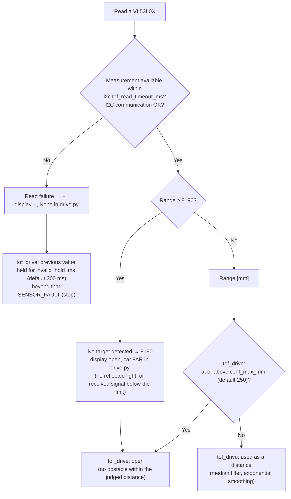

The window title and the header show the application's version. Next to it the header shows **PC の Wi-Fi**, the name of the network this PC is currently connected to. It turns red, and the event is logged, when the PC leaves the network it was on when it connected to the car (normally `RumiCar`). Windows may automatically switch from an access point without Internet access to another network, so check this display first when communication is interrupted unexpectedly (section 10). If the network name cannot be obtained on Windows 11 24H2 or later, turn on Settings → Privacy & security → Location → "Let desktop apps access your location" (Windows treats network names as location data).

### Manual operation

In manual mode the car is operated with the **driving pad** in the driving card, mouse or touchpad scrolling, and the arrow keys. Steering has three states (left / centre / right: the steering motor is on or off); the drive is continuous from 0 to 100 % in 1 % steps. Pad coordinates are normalised with the centre as the origin and the edges at ±1.

| Input | Steering | Drive |
|---|---|---|
| **Press and drag on the pad** (left mouse button; on a touchpad, click and hold, or tap-and-drag) | Left / right at \|x\| ≥ 0.33 (left / right third), back to centre at \|x\| < 0.22 (hysteresis) | Upper half forward, lower half reverse. \|y\| ≤ 0.12 is stop; beyond it the drive rises linearly to 最大出力 at the edge. **Releasing stops the car** |
| **Vertical scroll** (wheel, two fingers up/down on a touchpad; over the pad or the image) | — | Changes a speed set-point and **keeps driving at that speed**: 5 % per wheel notch. Between forward and reverse the set-point stops at 0; scrolling again after a 0.4 s pause continues in the other direction |
| **Horizontal scroll** (two fingers sideways, a tilting wheel, Shift + wheel) | Left / right while scrolling, centre 0.25 s after the last scroll event | — |
| **Arrow keys** | ← → while held | ↑ ↓ forward / reverse at 最大出力 while held |
| **Stop** | Space, right or middle click on the pad, the 停止 button. Also when the window is deactivated (switching to another application) | |

Precedence: the pad while pressed, otherwise held keys, otherwise scrolling (← → can be combined with the scroll set-point: set a speed by scrolling and steer with ← →). Pressing the pad or ↑ ↓ resets the scroll set-point to 0, so releasing never resumes a previous speed. 最大出力 (default 60 %) limits all three inputs, and the car's `max_drive_permille` limits further. If horizontal scrolling steers in the wrong direction with your touchpad settings, tick 左右スクロールの向きを反転.

In manual mode the car makes an emergency stop when the heartbeat is lost for 1 s (table above).

Press 「切断」 to disconnect. In auto mode the car continues driving after the application is closed (it is designed to drive without a PC). To stop it, use the emergency stop or switch the car off.

## 6. Recording driving data and improving the decision data

### 6.1 Recording

On connection (or with 「収録開始」 when automatic recording is off), one folder per recording is created under the destination:

```
RumiCarData/
  sessions/
    RumiCar_20261018-123456/      <car name>_<start time, UTC>
      frames/000001.jpg …        images (sequence number within the recording)
      meta.jsonl                 one line per frame: {"index":1,"image":"000001.jpg","received":"…","header":{…status received from the car…}}
      session.json               summary: scenario, note, the logic/pack the car used at the start (with description, capabilities, source scenarios), frame and image counts, number of gaps, whether under-voltage occurred
  scenarios.json                 scenario names used so far (newest first, with use counts)
```

`header` contains, for that frame, the ToF values, the logic state and decision (steer, drive), the values actually output to the motors, the drive mode, the e-stop state, the logic and pack names and versions (`logic_name` / `pack_id`), the power flags (`throttled`), and the image's sequence number and timestamp.

**Naming scenarios**: before recording, enter the name of the scene in the シナリオ box — "壁のみの走行データ" (walls only), "信号機ありケース1" (traffic light, case 1), "信号機と交差点ロジックあり" (traffic light and intersection) — so that the recordings to use can be selected when building decision data. Names used before can be selected from `scenarios.json`.

### 6.2 Improving the data with the Claude desktop app

1. Open the `RumiCarData` folder (or its `sessions` folder) in the Claude desktop app, let it read the recordings and instruct the improvements.
2. The decision data of the driving logic `tof_drive` is a single parameter file, `params.json`. Spec section 3.7 lists every key with its meaning and default (for example `d_turn_enter_mm`, the forward distance at which a turn starts; `v_max`, the top speed; `accel_permille_per_s`, the rate of change when accelerating).
3. Put the result in a folder with this structure (`manifest.json` can be created with `car/tools/make_manifest.py`, which needs only the Python 3 standard library):

```
base-tof-0.2.0/            folder name is <id>-<version>
  params.json              every key is required
  manifest.json            python car/tools/make_manifest.py pack base-tof-0.2.0 --id base-tof --version 0.2.0 --logic tof_drive \
                               --description "Walls only; turns start earlier (d_turn_enter_mm 220)" \
                               --capability walls --scenario "壁のみの走行データ" --parent base-tof-0.1.1
```

Give the version (`0.2.0` etc.) a new number that does not duplicate a version installed on the car.

`--description` (description of the version), `--capability` (supported scenes: `walls`, `traffic_light`, `vehicle`, `intersection`; repeatable), `--scenario` (the recorded scenarios used; repeatable) and `--parent` (the version it was derived from) are optional; when given, the drive manager shows them in 判断データ / 対応機能 / 学習元 and in the version list, which identifies the logic and data in use. `python car/tools/make_manifest.py show <folder>` displays them.

### 6.3 Sending to the car and switching

1. With the drive manager connected, press **「送る…」** in 版の管理 and select the folder. The application verifies the manifest before sending.
2. When the new version appears in the list, select it and press **「有効化」** (activate). The car verifies it and switches at the next frame (also while driving). If verification fails, the car continues with the current version and the reason is logged.
3. If there is a problem, **「データを戻す」** returns to the previous pack. Versions no longer needed can be selected and deleted with 「削除」 (the active and the previous version cannot be deleted).

A rebuilt driving logic (the `tof_drive` `.so`) is sent the same way (`make_manifest.py logic …`, spec section 4).

### 6.4 Creating a video from a recording

「動画を作る…」 in the drive manager takes a session folder and creates `video.avi` from its `frames/` (Motion JPEG: the received JPEGs are stored without re-encoding, so there is no quality loss; 20 frames/s on a real-time timeline from the image timestamps; where frames are missing the previous frame is held for up to 1 s, and longer gaps are removed). VLC, Windows Media Player and ffmpeg can play it. From the Claude desktop app use `python car/tools/session_video.py <session folder>`, which performs the same processing (Python 3 standard library only). To convert to MP4: `ffmpeg -i video.avi -c:v libx264 -pix_fmt yuv420p video.mp4`.

## 7. Learning from images (traffic lights, a vehicle ahead, intersections)

### 7.1 How it works

The car keeps the ToF (distance sensor) driving as its base. In addition, each camera image is converted into features (320×240 reduced to 1/5 and divided into 8×6 cells; per cell, the pixel counts of 8 colour classes (6 hues plus bright and dark) and the sums of value, saturation and value gradients (horizontal, vertical) — 576 integers), to which **detectors learned from the recordings** are applied. There are two kinds of detector: **local detectors**, which output a position in the image (red light, green light, vehicle; evaluated on a 3×3 window of cells), and **global detectors**, which output a state of the whole image (an intersection ahead, etc.). Based on the detection results, three behaviours give the ToF driving a "speed cap" and a "steering mode".

**Figure 4** Feature extraction and detectors

<!-- figure: en/04-features.mmd -->
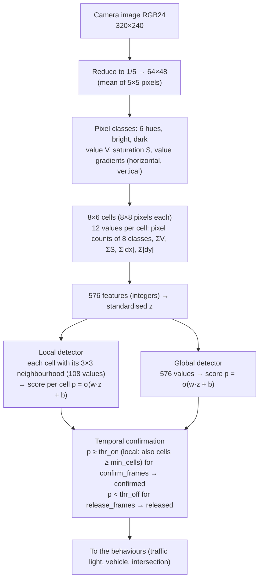

| Behaviour | Detectors | Action |
|---|---|---|
| `signal` | red / green light (local) | When the red light is detected for the configured number of frames: decelerate; when close: stop. When the green light is detected (or a configured time has passed since the red light was last detected): start |
| `vehicle` | vehicle (local) | When a vehicle is detected in the own lane (the centre columns of the image): follow at a gap without turning. If the gap stays unchanged while stopped, classify it as a parked vehicle and overtake on the side with more clearance on the left/right ToF (lane change to the passing side → alongside → return to the lane) |
| `intersection` | intersection with a road to the left / right (global) | When an intersection is detected: decelerate, stop where the side wall ends (a side ToF becomes open), then go straight, turn left or turn right as configured |

The three behaviours operate independently; where they overlap, the **lowest speed cap applies**. If a red light is detected during overtaking or turning, that manoeuvre is aborted and the car stops. The ToF logic's emergency brake, reversing recovery and sensor fault always take precedence (the image-based decisions only add constraints to the ToF driving and never disable its safe-side actions).

The learned result is a "decision data pack": `params.json` (ToF and behaviour parameters, text format), `vision.bin` (detector weights etc., a binary format the car can load quickly) and `manifest.json` (description, capabilities, source scenarios). It is sent to the car and switched exactly as in section 6. The driving logic `cam_drive` is bundled with the car (installed alongside `tof_drive`). A behaviour whose detectors are absent is disabled automatically, so functions can be added step by step: traffic lights first, then vehicles.

### 7.2 Required environment

- Python 3 with numpy and Pillow (`pip install numpy pillow`), in the Claude desktop app's environment or on the PC
- `car/tools/` from this repository (`train_pack.py`, `rumicar_vision.py`, `make_manifest.py`, `session_video.py`)
- Optional: `rumicar-replay` (GitHub Actions artifact `rumicar-replay-amd64`), which replays a recording through the actual logic so that stop/start decisions can be checked before sending

### 7.3 Procedure

**Figure 5** From learning to the car

<!-- figure: en/05-learning.mmd -->
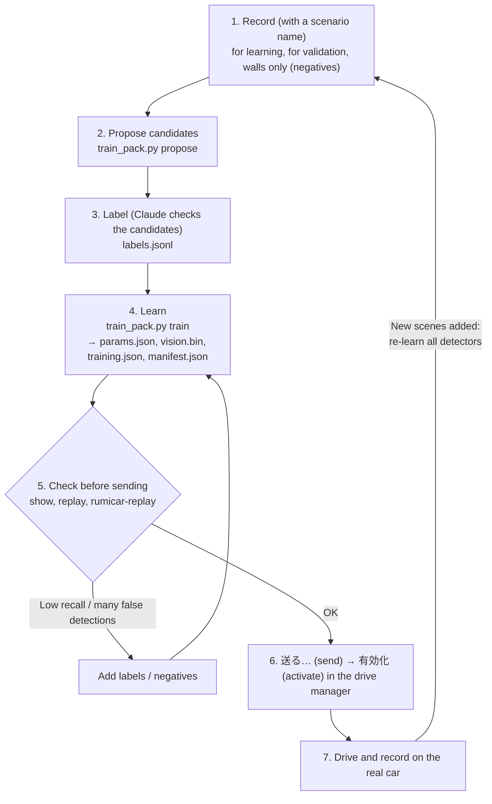

1. **Record**: drive a course with a traffic light (to capture red and green before starting, the car may be moved by hand in record-only mode) with a scenario name such as "信号機ありケース1". Recordings of a course without traffic lights ("壁のみの走行データ") are used automatically as "no traffic light in view" examples (negatives), so prepare those as well. Make at least two separate recordings, one for learning and one for validation.
2. **Label**: `python car/tools/train_pack.py propose <session> --detector traffic_light_red` writes candidate red regions (frame index and box) to `proposals_traffic_light_red.jsonl`. Let Claude read that folder, check the candidate frames (images in `frames/`) and write the correct ones into `labels.jsonl`. Likewise for the green light (`--detector traffic_light_green`). Candidate lines have the same format as `labels.jsonl` lines, and extra keys (`image`, `pixels`, etc., which record why the line was proposed) are ignored, so the lines can be used after deleting the unwanted ones. The format is as follows (one object per line; boxes are pixel coordinates [x0, y0, x1, y1] with x1/y1 exclusive):

```
{"index": 123, "objects": [{"name": "traffic_light_red", "box": [160, 60, 200, 110]}]}   <- local (box)
{"index": 456, "objects": [{"name": "vehicle", "box": [120, 140, 200, 220]}]}            <- vehicle ahead (enclose its body)
{"from": 300, "to": 380, "scene": ["intersection_left"]}                                 <- scene (whole image): frames 300..380 show an intersection ahead branching to the left
{"index": 200, "negative": true}                                                         <- explicitly no target in view
```

   `--detector vehicle` proposes vehicle candidates (frames in which the centre ToF reading was close; the box only marks the lane position, so adjust it to the vehicle's body). `--detector intersection_left` (or `_right`) proposes intersection candidates: counting back from the moment a side ToF reading changes from "wall" to "open" — the moment the car passes the intersection — the preceding 2 s (`--before-ms`) are proposed as "intersection visible ahead"; check the first and last frames and adjust the interval. Unlabelled frames are not used for learning. Checking about one frame in twenty is sufficient (frames in intervals with similar features are filled in by the `propose` candidates). A labelled frame becomes a negative example for every detector not named on it (this is how the red tail lights of a vehicle are learned not to be a red light).

3. **Learn**:

```
python car/tools/train_pack.py train cam-signal-0.1.0 \
    --parent <the cam-base-0.1.1 folder taken from the car, or the previous version> \
    --sessions <recordings for learning>... --validate <recordings for validation>... \
    --negatives-from-scenario "壁のみの走行データ" \
    --detector traffic_light_red --detector traffic_light_green \
    --id cam-signal --version 0.1.0 --description "traffic light, case 1"
```

   `cam-base-0.1.1` is also in the repository at `car/packs/cam-base`. On completion `cam-signal-0.1.0/` contains `params.json`, `vision.bin`, `training.json` (learning record) and `manifest.json`, and the precision and recall of the detections on the validation recordings are displayed. If recall is low, add labels; if there are many false detections, add negatives (walls only). To add vehicles and intersections, learn all detectors together (`:global` marks a global detector):

```
python car/tools/train_pack.py train cam-town-0.1.0 --parent cam-signal-0.1.0 \
    --sessions <traffic-light recordings> <vehicle and intersection recordings>... --validate <validation recordings>... \
    --negatives-from-scenario "壁のみの走行データ" \
    --detector traffic_light_red --detector traffic_light_green \
    --detector vehicle --detector intersection_left:global --detector intersection_right:global \
    --intersection turn=left --id cam-town --version 0.1.0 --description "traffic lights and intersections"
```

   A behaviour's settings are added to `params.json` only when the pack contains its detectors (`behaviours on: signal, vehicle, intersection` is printed). If only one side of intersections is learned, the other detector name is left empty (no intersection on that side).

4. **Check before sending**: `python car/tools/train_pack.py show cam-signal-0.1.0` (contents and enabled behaviours), `replay cam-signal-0.1.0 <session>` (per-frame detections) and `rumicar-replay <cam_drive folder> cam-signal-0.1.0 <session>` (replay through the actual logic; a transition CRUISE → SIGNAL_APPROACH → SIGNAL_STOP → SIGNAL_RESUME means stopping and starting work; for a vehicle FOLLOW → OVERTAKE_OUT → OVERTAKE_PASS → OVERTAKE_IN, for an intersection INTERSECTION_APPROACH → INTERSECTION_STOP → (INTERSECTION_CROSS →) INTERSECTION_TURN). A replay feeds in the recorded ToF values unchanged, so scenes in which the car's own motion would change the ToF values (overtaking) only progress as far as the recording does (stopping, deceleration and the start of the lane change can be checked).
5. **Send to the car**: in the drive manager's 版の管理, select `cam_drive-0.2.0` (bundled) and 有効化, then 送る… `cam-signal-0.1.0` and 有効化. The status panel's 判断データ / 対応機能 / 学習元 show the sent version's description, "壁 / 信号機" and the scenarios used for learning. With 「判断を重ねる」 on, detection boxes (red light = red, green light = green, vehicle = sky blue, intersection = orange frame around the whole image; thick when confirmed) and scores are drawn over the image. 判断状態 also shows the meaning of the state, e.g. `FOLLOW（前方車両に追従）`.
6. **Improve**: add recordings and learn again with `--parent cam-signal-0.1.0 --version 0.2.0`. When recordings of new scenes (vehicles, intersections) are added, the rule is to **re-learn all detectors**, including the existing ones (the new scenes become negatives for the existing detectors, e.g. a vehicle's tail lights are not falsely detected as a red light). `--keep-parent-detectors` is for correcting some detectors without adding scenes (the lineage is kept in the manifest's `parent`).

### 7.4 Traffic-light behaviour (the `signal` part of params.json)

| Key | Default | Meaning |
|---|---|---|
| `red_detector` / `green_detector` | `traffic_light_red` / `traffic_light_green` | Detector names. On a course without a green light set `green_detector` to `""` and start with `resume_without_green_ms` |
| `stop_min_cells` | 2 | When the red light is detected in at least this many cells it is judged "close" and the car stops (before that it only decelerates) |
| `approach_v` | 500 | Speed cap (per mille) from detecting the red light until stopping |
| `min_stop_ms` | 1000 | Minimum stop time |
| `resume_without_green_ms` | 3000 | Time from the red light no longer being detected until starting (0 = wait until the green light is detected) |
| `resume_ignore_ms` | 1500 | Time after starting during which red-light detections are ignored (to avoid stopping again while passing) |

Override with `--signal key=value` of `train` (e.g. `--signal stop_min_cells=3`).

**Figure 6** State transitions of the traffic-light behaviour

<!-- figure: en/06-signal.mmd -->
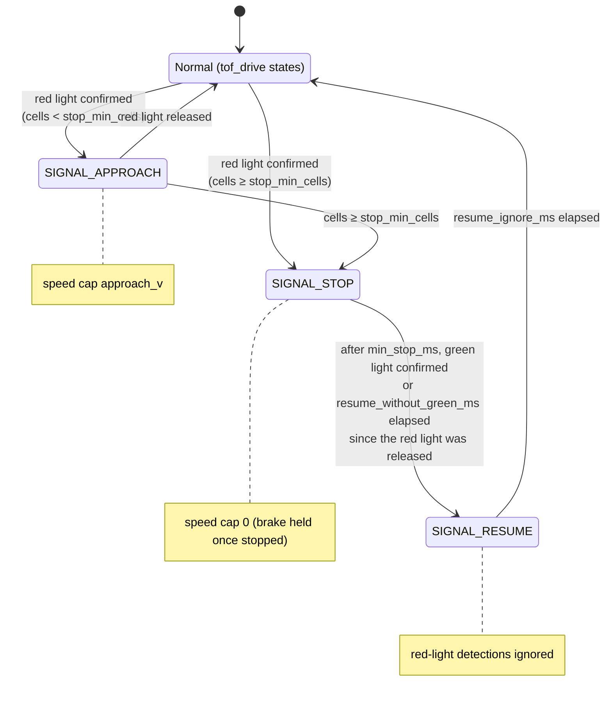

### 7.5 Vehicle behaviour (the `vehicle` part of params.json)

If this section (`vehicle`) is absent from `params.json` the behaviour is disabled. If present, every key is required (`train` adds it automatically to packs that contain the `vehicle` detector; override with `--vehicle key=value`). All distances are values after `tof_drive`'s processing; readings at or above `tof.conf_max_mm` (including no target detected) are treated as "open".

| Key | Default | Meaning |
|---|---|---|
| `detector` | `vehicle` | Name of the local detector |
| `lane_cols` | 4 | The detected vehicle is judged to be in the own lane only when its best cell (the cell with the highest score) lies in this many centre columns of the grid (columns 2–5 of 8) |
| `follow_gap_mm` | 150 | Minimum gap (centre ToF) to the vehicle ahead; at or below it the speed cap is 0 (stop). Must be greater than `tof.d_emergency_mm` and less than `tof.conf_max_mm` |
| `follow_band_mm` | 80 | While the gap widens from `follow_gap_mm` by this amount, the cap rises linearly from 0 to `follow_v` |
| `follow_v` | 700 | Speed cap while following (per mille); also applies while the vehicle is detected only by the camera and not yet by the ToF |
| `parked_confirm_ms` | 2000 | When the car has been stopped behind the vehicle for this long without the gap widening, the vehicle is classified as parked |
| `still_delta_mm` | 20 | If the gap widens by more than this while waiting, the vehicle is judged to have started moving and the judgement restarts |
| `overtake_side` | `open` | Side to overtake on: `left`, `right` or `open` (the side with the larger left/right ToF distance; equal → right) |
| `side_clear_mm` | 120 | Overtaking is possible if that side's ToF reads at least this (or open); otherwise wait in `FOLLOW_WAIT` |
| `overtake_v` | 500 | Speed cap during overtaking |
| `out_ms` | 500 | Duration of the lane change to the passing side (maximum steering towards the passing side) |
| `pass_min_ms` / `pass_max_ms` | 800 / 3000 | Minimum / maximum duration of driving alongside (steering back to neutral, straight ahead) |
| `pass_clear_mm` / `pass_clear_ms` | 150 / 300 | After the inner (vehicle-side) ToF has read below this once (vehicle detected alongside), a reading at or above it for this long means passing is complete |
| `in_ms` | 500 | Duration of the return to the lane (maximum steering to the opposite side) |
| `ignore_ms` | 1500 | Time after overtaking during which vehicle detections are ignored. Also, if the camera does not detect the vehicle for this long while following, following ends and control returns to the ToF decisions (if the car is too close for the vehicle to be detected, the ToF logic avoids it as an obstacle) |

Overtaking is open-loop control divided by time (because the steering has only three states: left, centre, right). Adjust the lane-change and return durations to the course and the speed.

**Figure 7** State transitions of the vehicle behaviour

<!-- figure: en/07-vehicle.mmd -->
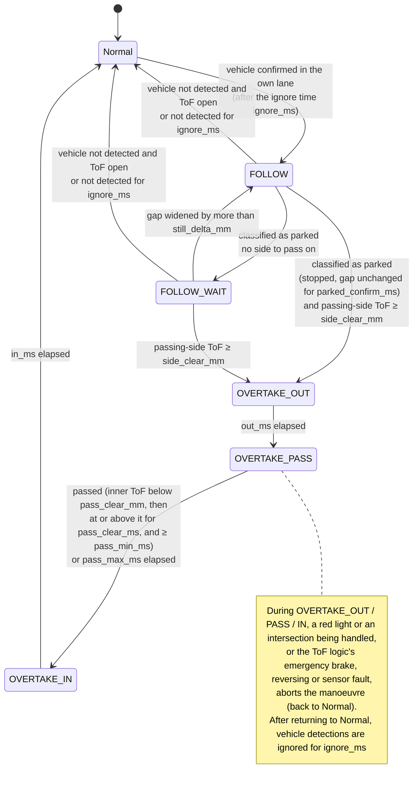

### 7.6 Intersection behaviour (the `intersection` part of params.json)

If this section (`intersection`) is absent the behaviour is disabled. If present, every key is required (`train` adds it automatically to packs that contain `intersection_left` or `intersection_right`; override with `--intersection key=value`).

| Key | Default | Meaning |
|---|---|---|
| `left_detector` / `right_detector` | `intersection_left` / `intersection_right` | Detectors (global) for an intersection branching to the left / right. One may be `""` (not both) |
| `approach_v` | 500 | Speed cap from detecting the intersection until stopping |
| `stop_trigger` | `side_open` | Stop condition. `side_open` = when the left or right ToF reads `open_mm` or more (the wall ends); `detector` = immediately when the detector is confirmed (courses without walls, where only images just before the intersection were learned) |
| `open_mm` | 200 | A side ToF reading at or above this (or open) is judged "open" |
| `stop_ms` | 1000 | Stop time (while a red light is detected, the car does not start until the light turns green) |
| `turn` | `straight` | Path after stopping: `straight`, `left`, `right`, or `detector` (turn towards the detected side; both sides detected → straight) |
| `turn_v` | 500 | Speed cap while driving straight waiting for the turn side to open, and while turning |
| `cross_max_ms` | 2000 | Maximum time to drive straight waiting for the turn side's ToF to become open (if it does not, the manoeuvre ends going straight) |
| `turn_ms` | 900 | Duration of maximum steering towards the turn side |
| `ignore_ms` | 3000 | Time after completion during which intersection detections are ignored |

**Figure 8** State transitions of the intersection behaviour

<!-- figure: en/08-intersection.mmd -->
```mermaid
stateDiagram-v2
    state "Normal" as NORMAL
    [*] --> NORMAL
    NORMAL --> INTERSECTION_APPROACH: intersection detector confirmed<br/>(stop_trigger = side_open)
    NORMAL --> INTERSECTION_STOP: intersection detector confirmed<br/>(stop_trigger = detector)
    INTERSECTION_APPROACH --> NORMAL: confirmation released
    INTERSECTION_APPROACH --> INTERSECTION_STOP: left or right ToF ≥ open_mm
    INTERSECTION_STOP --> NORMAL: stop_ms elapsed, no red light<br/>path straight
    INTERSECTION_STOP --> INTERSECTION_CROSS: stop_ms elapsed, no red light<br/>path left / right
    INTERSECTION_CROSS --> INTERSECTION_TURN: turn-side ToF ≥ open_mm
    INTERSECTION_CROSS --> NORMAL: cross_max_ms elapsed (ends straight)<br/>or red light / ToF emergency action
    INTERSECTION_TURN --> NORMAL: turn_ms elapsed<br/>or red light / ToF emergency action
    note right of INTERSECTION_STOP
        The path is decided on stopping: turn = straight / left / right / detector
        (detector: the detected side; both sides → straight).
        APPROACH does not start during overtaking.
        After returning to Normal from STOP, CROSS or TURN, intersection detections are ignored for ignore_ms
    end note
```

### 7.7 How the behaviours combine

- The speed cap is the minimum over the three behaviours. A red light detected while following gives `SIGNAL_STOP`; reaching an intersection gives `INTERSECTION_STOP`.
- The parked-vehicle judgement does not progress while a red light or an intersection is being handled (so that a vehicle waiting at a light is not overtaken). If a red light or an intersection is detected during overtaking, the manoeuvre is aborted and the car stops; following then restarts.
- At an intersection stop the car does not start until the red light is no longer detected (green), and a red light detected while crossing or turning aborts the manoeuvre.
- The state shown as 判断状態 is that of the behaviour deciding speed and steering, in the priority order red light (`SIGNAL_APPROACH` / `SIGNAL_STOP`) → intersection → vehicle → starting (`SIGNAL_RESUME`). During the ToF logic's emergency brake, reversing or sensor fault, that state is shown.

### 7.8 Troubleshooting

| Symptom | Action |
|---|---|
| Stops for objects other than red lights | Add walls-only recordings, or recordings containing that object, as negatives. Check the precision in `training.json`. Raise `--thr-on` |
| Stop position too far from / too close to the light | Increase / decrease `stop_min_cells`. Check that the camera is mounted at the same angle as during recording |
| Does not start after stopping | Check that the green detector detects the green light (検出 field). If not, set `resume_without_green_ms` |
| Avoids the vehicle instead of stopping behind it | With 判断を重ねる on, check that the vehicle's box appears in the centre columns (`lane_cols`). If detection is lost when the vehicle body fills the view at close range, add labels from close-range recordings. Raise `follow_gap_mm` |
| Contact or wide swing during overtaking | Adjust `out_ms`, `in_ms`, `overtake_v`. If the wall on the passing side is close, raise `side_clear_mm` (the car then waits) |
| Does not overtake the parked vehicle | `FOLLOW_WAIT` means both sides are below `side_clear_mm`; `FOLLOW` means the vehicle detection is lost (row above) or a red light / intersection is being handled |
| Does not stop at the intersection | Check with `replay` that `intersection_*` is confirmed. If it is and the course has walls, check that `open_mm` is less than the distance to the wall. On courses without walls set `stop_trigger` to `detector` |
| Does not turn at the intersection | The turn side's ToF did not become open (`open_mm` or more) within `cross_max_ms`. With `turn=detector`, detection on both sides means straight |
| The sent version shows 検証失敗 | Run `make_manifest.py verify`. If the vision.bin self-test does not match, the camera setting (320×240) differs from the one used for learning. Check that the learning tool and the car versions correspond (ABI 2) |
| `rumicar-replay` and the car give different results | Recordings are JPEG while the car uses uncompressed images, so small differences occur. Large differences suggest changed lighting; add recordings under that lighting |
| A detection stays confirmed and is never released | In `show`, check that the second threshold (release) is above the score when no target is present. `train` places it above the top 1 % of negative scores; re-learning with a smaller `--hysteresis` raises it |

## 8. Logging in to the car (SSH)

```sh
ssh rumicar@10.42.0.1          # password rumicar
sudo journalctl -u rumicar-core -f     # core log (state transitions, switches, errors)
systemctl status rumicar-core          # service status
rumicar-activate show                  # active / previous versions and the last switch result
sudo nano /etc/rumicar/core.json       # settings (then sudo systemctl restart rumicar-core)
```

Main settings in `/etc/rumicar/core.json` (spec 3.3): `car_name`, `startup_mode` (start-up drive mode: `record_only`, the default, or `auto` to drive at power-on), `max_drive_permille` (drive limit, 1000 = 100 %), `auto_accel_permille_per_s` (rate at which the permitted drive increases on entering auto mode; the default 1125 takes about 0.89 s from 0 to 100 %; 0 = no limit), `camera.enabled`, `camera.on_demand` (run the camera only while a PC is connected or in auto mode; default true), `camera.fps`, `network.heartbeat_timeout_ms`, `network.ap_start` (`core`, the default: the core starts the access point; `boot`: NetworkManager does it), `network.wifi_txpower_dbm` (upper limit of the radio's transmit power; 0 = driver default; try about 10–14 if battery voltage drops are a problem), `power.throttled_path` (under-voltage / throttling monitor; an empty string disables it).

## 9. Updating

### 9.1 Whole image

Write the image of a newer Release to the SD card (section 2). Recordings are stored on the PC and are not lost.

### 9.2 Package only

Transfer `rumicar-zero2cam_<version>_arm64.deb` from the Release to the car and install it (if installed while driving, the motors stop once as the core restarts).

```sh
scp rumicar-zero2cam_<version>_arm64.deb rumicar@10.42.0.1:
ssh rumicar@10.42.0.1
sudo apt install ./rumicar-zero2cam_<version>_arm64.deb
```

The required libraries are included in the image, so no Internet connection is needed. If `/etc/rumicar/core.json` or the access-point profile was modified, apt asks whether to replace it (unmodified files are updated without asking). Bundled logic / pack versions are not overwritten if a directory of the same version already exists on the car (only new versions are added).

### 9.3 When the car needs an Internet connection

The car normally operates as an access point and does not connect to external networks. To install packages with `apt`, temporarily switch to the home Wi-Fi (this stops the `RumiCar` access point; a reboot restores it):

```sh
sudo nmcli device wifi connect "<home SSID>" password "<password>"
```

### 9.4 Version numbering

There are three kinds of version number, each updated independently.

| Kind | Example | Scope and where it appears |
|---|---|---|
| Core (product) version | `v0.3.2` | The Release tag. The SD-card image, the `.deb`, the drive manager and the car's `core_version` share it. Shown as `本体 <version>, このアプリ <version>` in the log on connection, and in the application's title |
| Logic version | `tof_drive-0.2.0`, `cam_drive-0.2.0` | One number per logic (`TOF_DRIVE_VERSION` / `CAM_DRIVE_VERSION` / `PY_DRIVE_VERSION` in `car/CMakeLists.txt`, `version` in its manifest). Shown in the version list and in the status panel's 版（ロジック／データ） |
| Pack (decision data) version | `base-tof-0.1.1`, `cam-base-0.1.1`, your own `cam-signal-0.1.0` | `version` in each pack's `manifest.json`. Give a pack you learned yourself a number that does not duplicate a version installed on the car (section 7) |

The core 0.3.2 Release bundles `tof_drive-0.2.0`, `cam_drive-0.2.0`, `py_drive-0.1.1`, `base-tof-0.1.1`, `cam-base-0.1.1` and `py-sample-0.1.1`. Even when the core and a logic carry the same number, the two numbers are independent.

**Builds that are not a release** (the `.deb`, SD-card image and application made by GitHub Actions for anything other than a tag) carry `+g` and the first 7 characters of the commit after the number (e.g. `0.2.1+g1a2b3c4`), to distinguish them from tagged releases. Debian orders them `0.2.1` < `0.2.1+g1a2b3c4` < `0.2.2`. If the numeric parts (before the `+`) of the car's core version and the application version differ, a warning is logged on connection.

## 10. Troubleshooting

| Symptom | What to check |
|---|---|
| `RumiCar` does not appear in the Wi-Fi list | Wait 1–2 minutes after boot. If SSH is available, check that `nmcli connection show` lists `RumiCar-AP`, that `sudo journalctl -u NetworkManager -b` shows no errors, and that `iw reg get` reports `JP` |
| The application cannot connect | Is the PC connected to `RumiCar` with a `10.42.0.x` address (`ipconfig`)? Firewall permission. On the car: `systemctl status rumicar-core` |
| No image | On the car: `sudo journalctl -u rumicar-core -b \| grep -i camera`. Camera ribbon orientation. Is the camera listed by `rpicam-hello --list-cameras`? |
| The car does not drive | After boot it waits in record-only mode (press 「自動」 in the application; to drive without a PC set `startup_mode` to `auto`). Does `sudo journalctl -u rumicar-core -b` begin with `hardware bring-up failed`? (The I2C/PWM settings are appended to `/boot/firmware/config.txt`.) Is the e-stop active (「非常停止解除」 in the application)? If a ToF reading stays `--` (read failure) for longer than `invalid_hold_ms` (default 300 ms), the car stops in SENSOR_FAULT |
| Power cuts out or the car reboots during start-up (dry cells) | Since v0.1.3 the core starts sensors → Wi-Fi → camera in sequence and keeps the motors stopped until 「自動」 is selected, so that high-current functions (Wi-Fi, camera, motors) do not operate simultaneously at start-up. If it still occurs: replace the cells with fresh or rechargeable (NiMH) ones; reduce the transmit power with `network.wifi_txpower_dbm` (about 10); check whether the 電源 field in the application shows 「低電圧」 (on boards that report it, this helps isolate the cause). If it occurs while driving, lower `max_drive_permille` to limit the current during acceleration |
| Wi-Fi disappeared | If the core (rumicar-core) stops, the access point is not started either, but `rumicar-ap.timer` retries from 90 s after boot and then every 60 s. Check with `systemctl status rumicar-ap.timer` and `nmcli connection show --active` |
| The PC disconnects from `RumiCar` by itself | The car's access point has no Internet access, so Windows may judge it as having no Internet connection and switch to another registered Wi-Fi network. If the application's PC の Wi-Fi turns red, this is the cause. Countermeasures: in Windows' Wi-Fi settings set `RumiCar` to "Connect automatically" and turn "Connect automatically" off for other networks (home, office) only while driving; or drive where other networks are out of range. A PC connected to the Internet over wired LAN can dedicate its Wi-Fi to the car |
| Sudden start immediately after switching to auto | Since v0.3.0 the permitted drive increases from 0 when auto mode is entered (`auto_accel_permille_per_s`; the default 1125 takes about 0.89 s from 0 to 100 %). If it is too fast, lower 自動の最大出力 in the application (reset by a core restart; start a first drive at 30–50 %). To limit it permanently, use the car's `max_drive_permille` |
| My own program does not run | Errors at load time are logged in the application with the reason (`drive.py の N 行目 …`, the line number in drive.py). Errors after the start and `print()` output are recorded in the car's log (`sudo journalctl -u rumicar-core -f`). If `loop()` does not complete within 30 ms, that frame brakes; if there is no response for 1 s or more, the program is stopped (`time.sleep()` and endless loops must not be used). Section 11 |
| `hardware bring-up failed: open /dev/i2c-1` | The v0.1.1 image had no setting to load the `i2c-dev` kernel module, so `/dev/i2c-1` was not created. `sudo raspi-config` → Interface Options → I2C → Yes resolves it (persists across reboots). Not needed with the v0.1.2 and later images and packages |
| A switch fails | The reason recorded in the application's log (manifest mismatch, missing required keys, logic-name mismatch, etc.). `rumicar-activate show` on the car |
| SSH password rejected | The first-boot setup may not have been applied yet. Reboot and wait a few minutes |

Please report problems in [Issues](https://github.com/RumiCar-group/RumiCar-Zero2Cam/issues) with the contents of the application's log or the output of `sudo journalctl -u rumicar-core -b`.

## 11. Your own driving program (Python)

Besides the bundled driving logics (`tof_drive`, `cam_drive`), the car can be driven by **a Python program written by the user**. The logic `py_drive` executes the `drive.py` of the pack sent to the car. This is independent of the learning pipeline (section 7); it is for writing the "decide steering and drive from the distance sensor values" part yourself. No compiler or development environment is required: a text editor (even Notepad) and the drive manager are sufficient to write and send a program.

### 11.1 Procedure

1. Copy the sample in `car/packs/py-sample/` (`drive.py` and `params.json`) to any folder on the PC (e.g. `C:\Users\<you>\RumiCarData\my-drive`). The folder name becomes the name of the data (pack) (characters other than letters and digits are replaced by `-`).
2. Open `drive.py` and rewrite the body of `loop(car)` (it works unchanged for a first try).
3. Connect to the car and select that folder with **自分のプログラムを送る…** in 版の管理. The application creates the `manifest.json`, sends the folder and activates the logic `py_drive` together with the data (「有効化: ロジックも py_drive-… に切り替えます」 is logged).
4. Press 自動 to start driving. At first, setting 自動の最大出力 to 30–50 % is recommended.
5. After editing, run 自分のプログラムを送る… again. Every send creates a new version (the version number is the send time), and データを戻す returns to the previous one.

If `drive.py の N 行目 …` is logged in the drive manager, fix that line of drive.py. `print()` output and errors after the start are recorded in the car's log (`ssh rumicar@10.42.0.1`, then `sudo journalctl -u rumicar-core -f`).

### 11.2 Writing drive.py

```python
def setup(car):          # once at the start (optional)
    car.state("START")

def loop(car):           # every 50 ms (20 Hz)
    if car.center < 150:           # close ahead
        car.steer(car.LEFT if car.left > car.right else car.RIGHT)   # towards the side with the larger distance
        car.drive(400)
    else:
        car.steer(car.CENTER)
        car.drive(car.params["speed"])   # a value from params.json
```

| Name | Description |
|---|---|
| `car.left` / `car.center` / `car.right` | Distance sensor values in mm; `car.FAR` (8190) when no target was detected, `None` on a read failure |
| `car.params` | The contents of `params.json` (a dict). Values that differ per car or course can be put here, so that tuning does not require changing the program |
| `car.time` / `car.dt` / `car.frame` | Seconds since the start / seconds since the previous `loop` / frame count |
| `car.steer(direction)` | `car.LEFT` / `car.CENTER` / `car.RIGHT` (strings such as `"left"` are also accepted). Steering has three states |
| `car.drive(value)` | Drive: `-1000` (reverse at maximum output) … `0` (stop) … `1000` (forward at maximum output). The values of `steer()` and `drive()` are held until changed |
| `car.brake()` / `car.stop()` | Brake / set the drive to 0 (coast to a stop) |
| `car.state("NAME")` | Name of the current processing state (letters, digits and `_`, up to 24 characters), shown as 判断状態 in the application |
| `print(...)` | Recorded in the car's log |

Your own `.py` files can be placed next to `drive.py` and imported. Only the Python standard library is available (numpy etc. are not installed on the car). Camera images are not available in `py_drive` (images are handled by the learning pipeline of section 7).

### 11.3 Safety control by the core

- The processing time of one `loop()` call is limited to **30 ms**; a frame whose processing does not complete within this time brakes (a late response is discarded). If there is no response for **1 s** or more, the program is stopped and the car stays braked (activate again to restart). Do not use `time.sleep()` or `while` loops that do not terminate.
- A frame in which an exception occurs brakes, and the program continues. Out-of-range values (`drive(5000)` etc.) also raise an exception.
- On entering auto mode the permitted drive increases from 0, and the car never exceeds 自動の最大出力 or its `max_drive_permille`. Manual mode, record-only and the emergency stop behave the same for every logic.
- The program runs in a process separate from the core, so the core's control period (50 ms) is maintained even if the program stops responding.

**Figure 9** Per-frame exchange between the core and drive.py (runner.py)

<!-- figure: en/09-py-drive.mmd -->
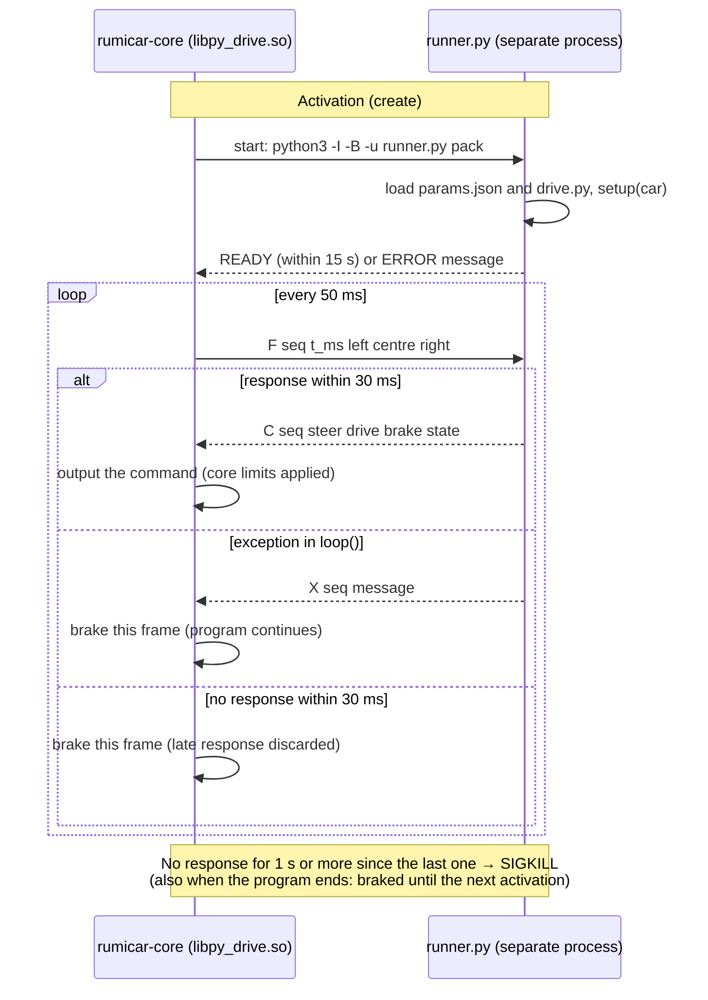

### 11.4 Notes

- A sent pack is stored in `/var/lib/rumicar/packs/<folder name>-<time>/`; `rumicar-activate pair py_drive-0.1.1 <pack>` switches to it over SSH (logic and data are switched as a pair).
- The ToF driving (`tof_drive`) is written in C++. To port processing written in Python to a full driving logic, use `car/logic/tof_drive/` as the reference.
- The sample `py-sample` is also bundled with the car, so `py-sample-0.1.1` can be activated from 版の管理 to check its behaviour without the repository on the PC.

---

# For developers

## Building the car side (Raspberry Pi OS Lite 64-bit / Debian 13)

```sh
sudo apt install build-essential cmake pkg-config libgpiod-dev nlohmann-json3-dev libssl-dev libturbojpeg0-dev libcamera-dev
cmake -S car -B build -DCMAKE_BUILD_TYPE=Release
cmake --build build --parallel
ctest --test-dir build --output-on-failure
sudo cmake --install build --prefix /usr/local   # manual install
```

To install on a car, use the Debian package (the CI artifact `rumicar-zero2cam-deb-arm64`, or configure with `cmake -S car -B build -DCMAKE_INSTALL_PREFIX=/usr` and run `cd build && cpack -G DEB`). `sudo apt install ./rumicar-zero2cam_<version>_arm64.deb` installs the core, the bundled logics / packs, the systemd services and the Wi-Fi access-point profile (SSID `RumiCar`, 10.42.0.1), and creates the state directory `/var/lib/rumicar`.

Without libcamera, build with `-DRUMICAR_WITH_CAMERA=OFF` (that core does not start a camera and drives on the ToF sensors only).

The driving logics are in `car/logic/`: `tof_drive` (ToF driving), `cam_drive` (camera-based decisions added to `tof_drive`: `vision_features` features, `vision_pack` for `vision.bin`, `vision_eval` detector evaluation with temporal confirmation, `cam_logic` the traffic-light, vehicle and intersection behaviours and their priorities) and `py_drive` (`runner.py` executes the pack's `drive.py` in a separate process, and `py_process` exchanges one line per frame; timeouts and abnormal termination brake; `test_py_drive` verifies it with the actual runner). The interface between the core and the logics is defined in `car/include/rumicar/logic_api.h` (ABI 2: the auxiliary output `aux` and `aux_name`). The Python implementation of the features and `vision.bin` is `car/tools/rumicar_vision.py`; `test_vision` verifies that it matches the C++ implementation exactly through the golden data in `car/tests/data/vision` (generated by `make_golden.py`). `car/tests/tools_smoke.py <build dir>` learns from synthetic recordings and verifies end to end with `rumicar-replay` stopping and starting, following and overtaking, and stopping at an intersection (also run in CI).

## Control loop and the ToF driving logic

Every 50 ms the core performs the processing of Figure 10. The state transitions of the driving logic `tof_drive` are shown in Figure 11 (spec 3.5, 3.7).

**Figure 10** Processing of one control-loop frame (50 ms)

<!-- figure: en/10-frame.mmd -->
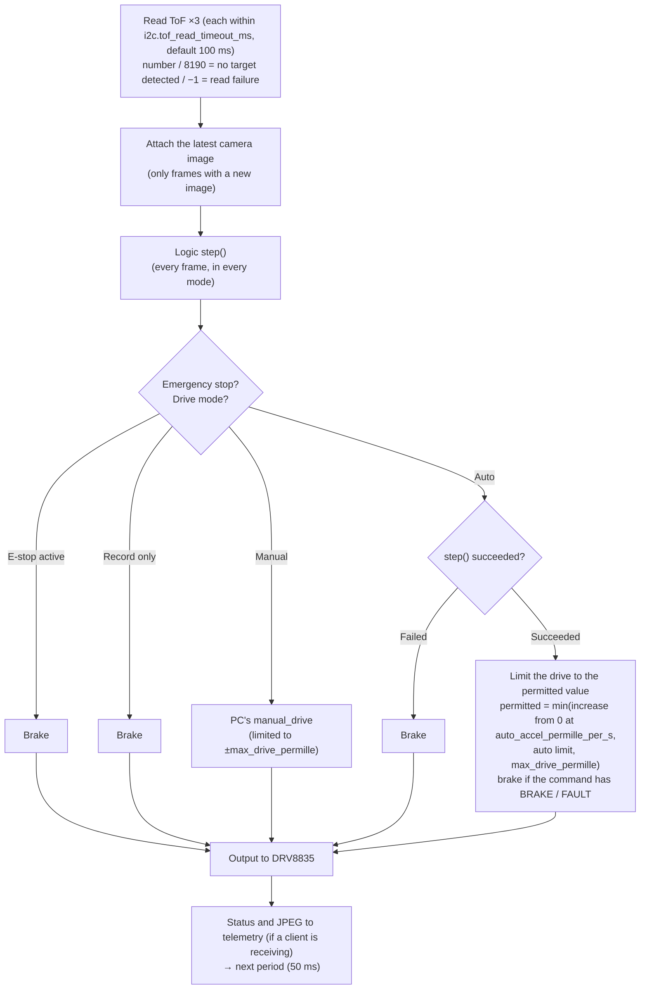

**Figure 11** State transitions of tof_drive

<!-- figure: en/11-tof-states.mmd -->
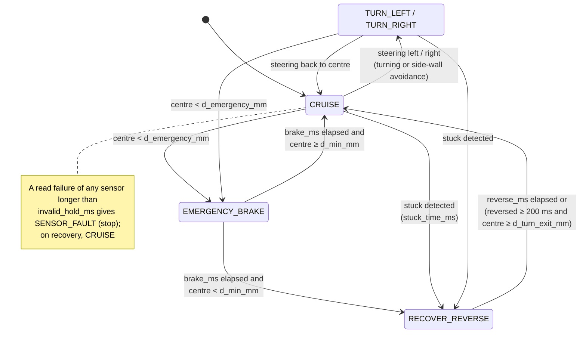

The figure sources are the `.mmd` (Mermaid) files in `docs/figures/ja` (Japanese) and `docs/figures/en` (English). The figures in the READMEs are copies of them; after changing a source, run `python3 docs/figures/sync_readme.py --write` (CI checks that they match with `--check`).

## Building the PC side (Windows / .NET 10 SDK)

```sh
dotnet build pc/RumiCar.sln -c Release
dotnet test pc/RumiCar.Protocol.Tests -c Release
dotnet publish pc/RumiCar.DriveManager -c Release -r win-x64 --self-contained -p:PublishSingleFile=true
```

## SD-card image and Releases

- The image is created by `car/image/build-image.sh` (root, arm64 host: the package is installed into the official Raspberry Pi OS Lite 64-bit image in a chroot and the first-boot settings are added). In CI the `image` job of `car.yml` creates it on pushes to main and on tags.
- A Release is created by tagging a commit on main as `vX.Y.Z` and pushing the tag (or by creating a Release with a new tag on GitHub's Releases page): `release.yml` then runs and attaches the image, the `.deb`, the PC application and `SHA256SUMS.txt`.
- **Write the number of the next Release into the sources first, then tag.** (1) In a pull request set `RUMICAR_VERSION` in `car/CMakeLists.txt`, `<Version>` in `pc/RumiCar.DriveManager/RumiCar.DriveManager.csproj` and the `assemblyIdentity version` (`X.Y.Z.0`) in `pc/RumiCar.DriveManager/app.manifest` to the same number, (2) merge it, (3) tag that merge commit `vX.Y.Z` and push the tag. `release.yml` first verifies that the tag matches those three places and is a commit on main, and stops without building if not (so that no Release is created whose tag and contents disagree).
- Builds other than a tag (main, pull requests) get `+g<commit>` appended by CI (`-DRUMICAR_VERSION_SUFFIX` in `car.yml`, `-p:InformationalVersion` in `pc.yml`); a local build keeps the number in the sources. The logic versions (`TOF_DRIVE_VERSION` / `CAM_DRIVE_VERSION` / `PY_DRIVE_VERSION`) are independent of the core version and are raised when a logic changes. They are also raised when the contents of a logic or pack change (including files other than the .so and the manifest's description), because the car does not overwrite a directory of the same version (9.2).

## Scope of this version (0.3.2)

- Car: ToF driving logic, control loop and safety control, drive modes (auto / manual / record_only; record_only at start-up) and emergency stop, Camera Module 2 capture (libcamera, RGB24 320×240 at 20 fps, operated only when needed) with JPEG transmission, control server (TCP 5600) and telemetry server (TCP 5601), Wi-Fi access point (NetworkManager, started in sequence by the core) and `set_wifi`, under-voltage / throttling monitoring, hot-swapping of logic / packs while driving (from the PC or over SSH), verification by manifests that also carry a description, capabilities and source scenarios, systemd services, Debian package
- PC: wire formats for control, telemetry, manifests and recording; the drive manager (connection, status and image, drive modes, e-stop, manual operation with pad, scrolling and keys, auto limit, display of the PC's Wi-Fi, recording with scenarios, version management with paired logic/pack switching, sending your own program, video creation from recordings)
- Car: the image logic `cam_drive` (stopping and starting at traffic lights, following a vehicle ahead and overtaking a parked vehicle, stopping at intersections and going straight or turning), the learned data `vision.bin`, the learning tool `train_pack.py`, the replay tool `rumicar-replay`, logic interface ABI 2
- Car: the logic `py_drive` that executes a Python program written by the user (`drive.py`) with the sample `py-sample`, limiting of the rate of increase of the permitted drive and the maximum output in auto mode (`set_auto_limit`), paired switching of logic and data (`activate_pair`)
- Distribution: standard SD-card image, GitHub Releases from tags (0.2.0: the logic interface changed from ABI 1 to ABI 2 and self-built logic must be rebuilt, hence the step up from 0.1.x; 0.2.1: manual operation changed to the driving pad and scrolling, the release verifies that tag and sources agree, builds that are not a release carry `+g<commit>`; 0.3.0: your own driving program, the auto limit and prevention of sudden starts, display of the PC's Wi-Fi; 0.3.1: wording in documents, screens and messages unified to technically precise terms (`py_drive` 0.1.1, `py-sample` 0.1.1, `cam-base` 0.1.1; no change in behaviour; 0.3.2: figures added to the READMEs and the specification, Japanese and English; no change in behaviour))
- Future work: recording and tuning on real cars (overtaking and turning durations, learning intersection images), choosing the turn according to the situation (currently fixed per pack, or towards the detected side)

## License

MIT License ([LICENSE](LICENSE))
