# RumiCar Zero2Cam

[English](README.en.md) | **日本語**

Raspberry Pi Zero 2 W と Camera Module 2 を搭載した RumiCar のソフトウェアです。
車載側（C++）、PC 側の走行管理アプリ（C# / .NET 10）、両者の通信形式、配布形式、自動ビルドを一つのリポジトリで管理します。

- 使い方（SD カードの作成から走行・収録・判断データの更新まで）：この README の [使い方](#使い方) 以下
- 仕様（設定、通信形式、配布形式、ビルド）：[docs/RumiCar-Zero2Cam 仕様書.docx](docs/RumiCar-Zero2Cam%20仕様書.docx)
- 設計の記録（調査結果、比較した案、決定の理由、画像ロジックの設計と実装の経緯。学習の参考資料）：[docs/RumiCar-Zero2Cam 設計の記録.docx](docs/RumiCar-Zero2Cam%20設計の記録.docx)
- 配布物：[Releases](https://github.com/RumiCar-group/RumiCar-Zero2Cam/releases)
- 解説動画（3 本、日本語・英語。ToF の読み取り値、自動モードの発進制御、駐車車両の追い越し）：[12. 解説動画](#12-解説動画)

## 構成

| ディレクトリ | 内容 |
|---|---|
| `car/` | 車載側。`rumicar-core`（制御ループ・ハードウェア制御・通信・差し替え機構）、走行ロジック `tof_drive`・`cam_drive`・`py_drive`（共有ライブラリ。`py_drive` は利用者が作成した Python プログラムを実行）、同梱パック `base-tof`・`cam-base`・`py-sample`、学習・再生ツール、単体テスト、Debian パッケージと SD カードイメージの作成 |
| `pc/` | PC 側。`RumiCar.Protocol`（通信形式・manifest・収録）、`RumiCar.Protocol.Tests`、`RumiCar.DriveManager`（WPF の走行管理アプリ） |
| `docs/` | 仕様書と設計の記録（いずれも .docx。教育目的で公開）、図のソース（`docs/figures`、Mermaid、日本語・英語） |
| `.github/workflows/` | 自動ビルド（`car.yml`: Debian 13 arm64/amd64 と SD カードイメージ、`pc.yml`: Windows、`release.yml`: タグによる Release） |

**図 1** システム構成（車・PC・Claude デスクトップアプリ）

<!-- figure: ja/01-system.mmd -->
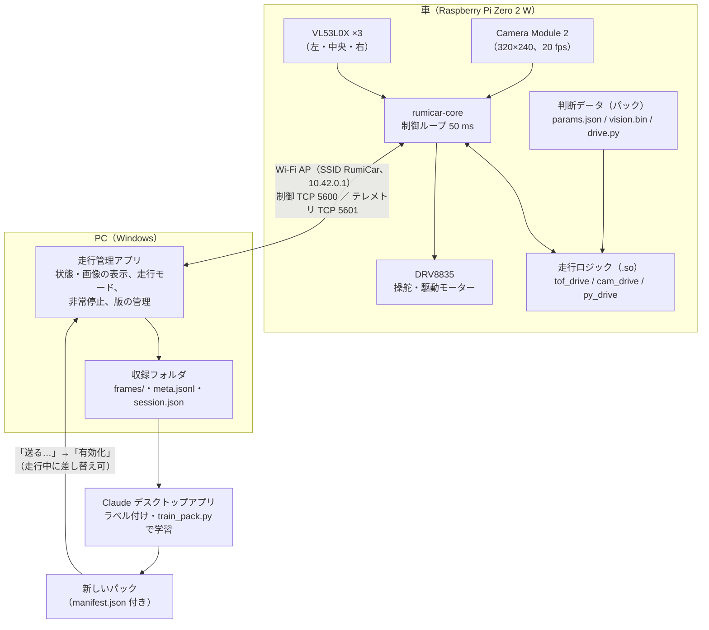

---

# 使い方

## 1. 必要な機材

| 機材 | 備考 |
|---|---|
| RumiCar の車体（Raspberry Pi Zero 2 W 搭載モデル） | DRV8835 モータードライバ、VL53L0X 距離センサー×3（左・中央・右）、Camera Module 2。配線は既存の RumiCar と同一（仕様書 3.4） |
| microSD カード | 8 GB 以上（Class 10 / A1 推奨） |
| Windows PC（64bit、Windows 10/11） | Wi-Fi 必須。走行管理アプリを実行 |
| SD カード書き込みソフト | [Raspberry Pi Imager](https://www.raspberrypi.com/software/) |

車は **電源投入だけでは走行しません**。起動後は「収録のみ」（モーターはブレーキ）で待機し、走行管理アプリで **「自動」** を選択すると走行を開始します（v0.1.3 以降。それ以前は電源投入と同時に走行を開始していました）。PC を使わず電源投入と同時に走行させる場合は `/etc/rumicar/core.json` の `startup_mode` を `auto` にします（8 章）。初回起動時や動作確認時は、車輪が床に接しないよう車体を台に載せてください。

## 2. SD カードの作成

1. [Releases](https://github.com/RumiCar-group/RumiCar-Zero2Cam/releases) の最新版から次の 2 ファイルをダウンロードします。
   - `rumicar-zero2cam-<版>-<日付>.img.xz` … 車の SD カードイメージ（約 620 MB）
   - `RumiCarDriveManager-<版>-win-x64.zip` … PC の走行管理アプリ
2. Raspberry Pi Imager を起動し、**デバイス**で「Raspberry Pi Zero 2 W」、**OS**で一番下の「Use custom」を選択してダウンロードした `.img.xz` を指定し、**ストレージ**で SD カードを選択します。
3. 「次へ」の後、「OS customisation settings を適用しますか」には **「いいえ（No）」** を選択します。ユーザー名・SSH・Wi-Fi・ホスト名はイメージに設定済みです。ここで Wi-Fi などを設定すると、イメージの設定（車がアクセスポイントになる）と競合します。
4. 書き込み完了後、SD カードを車に挿入します。

ダウンロードしたファイルの検証（任意）：Release の `SHA256SUMS.txt` の値と、PowerShell の `Get-FileHash <ファイル名>` の値が一致すれば正常です。

**Imager の一覧から選ぶ方法**（Raspberry Pi Imager 2.0 以降。イメージのダウンロードと検証を Imager が行います）：Imager の左下 **App Options → Content Repository → EDIT** で次の URL を登録して **APPLY & RESTART** すると、デバイス「Raspberry Pi Zero 2 W」の OS 一覧に「RumiCar Zero2Cam <版>」が出ます。選んでストレージを指定し、書き込みます（OS customisation の画面は出ません）。

```
https://github.com/RumiCar-group/RumiCar-Zero2Cam/releases/latest/download/rumicar-zero2cam.rpi-imager-manifest
```

この一覧（Release の `rumicar-zero2cam.rpi-imager-manifest`）は最新の Release を指し、Imager はイメージの SHA-256 を照合してから書き込み、書き込み後に SD カードを検証します。ダウンロードしてダブルクリックしても同じ一覧で Imager が開きます。元の一覧（Raspberry Pi 公式）には同じ画面で戻せます。

## 3. 初回起動

1. 車を台に載せ、電源を入れます。
2. 初回はパーティション拡張のため自動で 1 回再起動します。2〜3 分待ちます。
3. 起動後、`rumicar-core` がセンサーの初期化 → Wi-Fi アクセスポイントの起動 → （PC の接続後）カメラの起動 の順に処理します。乾電池の電圧低下を避けるため、消費電流の大きい機能は同時に起動しません（10 章）。**この時点では走行しません**（収録のみ）。走行させるには 4 章の手順で接続し、「自動」を選択します。

**図 2** 起動手順（消費電流の大きい機能を順に起動）

<!-- figure: ja/02-startup.mmd -->
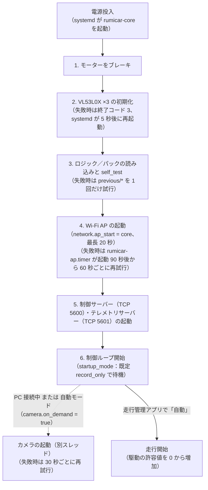

イメージの初期設定：

| 項目 | 値 |
|---|---|
| Wi-Fi アクセスポイント | SSID `RumiCar`、暗号化なし（公開イメージのため。教育用途として許容） |
| 車の IP アドレス | `10.42.0.1`（PC には DHCP で `10.42.0.x` を割り当て） |
| ログイン | ユーザー `rumicar`、パスワード `rumicar`、SSH 有効、ホスト名 `rumicar` |
| 無線の国設定 | JP（アクセスポイントの動作に必須） |

## 4. PC からの接続

1. PC の Wi-Fi で `RumiCar` に接続します（パスワードなし。「このネットワークは安全ではありません」と表示されても接続します）。
2. `RumiCarDriveManager-<版>-win-x64.zip` を展開し、`RumiCarDriveManager.exe` を実行します（インストール不要）。
   - 初回に「Windows によって PC が保護されました」（SmartScreen）が表示された場合は「詳細情報」→「実行」。実行ファイルに署名が無いためです。
   - 「Windows Defender ファイアウォール」の確認が表示された場合は「アクセスを許可する」。
3. 画面上部の「車両」が `10.42.0.1` のまま **「接続」** を押します。ログ欄に `車両 RumiCar, 本体 <版>` が記録され、状態欄に ToF の値・判断状態・画像が表示されれば接続完了です。
4. 走行させるには、走行モードの **「自動」** を押します。初回の走行時や、車・コースの挙動を把握していない段階では、事前に **「自動の最大出力」を 30〜50% に設定する** ことを推奨します（v0.3.0 時点の推奨値。挙動を確認しながら上げてください。5 章）。

## 5. 走行管理アプリ

| 項目 | 内容 |
|---|---|
| 車両／名前 | 車の IP アドレス（既定 `10.42.0.1`）と、収録フォルダ名に使う車の名前（既定 `RumiCar`） |
| 非常停止／非常停止解除 | 非常停止は走行モードに関係なくブレーキし、解除するまで走行しません。手動モードで heartbeat が 1 秒（`network.heartbeat_timeout_ms`）途絶えたとき、手動モード中に PC が切断したときにも自動で作動します |
| 画像 | 車のカメラの最新画像（320×240、約 20 フレーム/秒）。「画像を表示」をオフにすると画面表示だけを停止します（受信と収録は継続。PC の負荷を下げる場合に使用） |
| 状態 | 走行モード、非常停止（緑 = なし、赤 = 作動中・理由付き）、判断状態（CRUISE／TURN_LEFT／TURN_RIGHT／EMERGENCY_BRAKE／RECOVER_REVERSE／SENSOR_FAULT など）、ToF 左／中／右 [mm]（下表）、モーター出力、ロジックの判断、版（ロジック／データ）、**判断データ**（使用中のパックの名前・版と説明）、**対応機能**（壁／信号機／車両／交差点）、**学習元**（そのパックの作成に使用した収録シナリオと元の版）、**電源**（車のファームウェアが報告する低電圧・処理速度制限。通常は「正常（低電圧なし）」） |
| モーター出力／ロジックの判断 | 「`RC_steer(LEFT) / RC_drive(FORWARD, 191)`」の形式で表示します。RumiCar ライブラリ（Arduino の RumiCar-lib、Raspberry Pi 版の RumiCar.py、`drive.py`）でその指令を出すときに書く呼び出しと同じ語と数です。駆動の値は **PWM のデューティ**（0〜255、255 = 100%。150 なら全開の 150/255 ≒ 59% の信号）、方向は `FREE`（惰行）／`REVERSE`／`FORWARD`／`BRAKE`（両入力 High）。「モーター出力」は実際にモーターへ出力した値、「ロジックの判断」はロジックがそのフレームで算出した値（手動・収録のみ・非常停止中も表示） |
| 走行モード | **自動**：車のロジックが走行を制御／**手動**：PC から操作（下記「手動操作」）／**収録のみ**：モーターを停止したまま画像と状態を受信（手で車を動かしてデータを収集する場合に使用）。下に「起動時のモード」（既定は収録のみ）を表示 |
| 操縦パッド | 手動モードで有効（下記「手動操作」）。下に送信中の指令（例「`RC_steer(LEFT) / RC_drive(FORWARD, 115)`（パッド）」）、「最大出力」、「停止」、「左右スクロールの向きを反転」を配置 |
| 自動の最大出力 | 自動モードでロジックが出力する駆動（`RC_drive` の値 0〜255）の上限（既定 255）。車が保持し、本体の再起動で `max_drive_pwm`（既定 255）に戻ります。`max_drive_pwm` を超える値は設定できません。手動の「最大出力」とは独立しています。自動モードへの切り替え時は、駆動の許容値を 0 から `auto_accel_pwm_per_s` の傾きで増加させ、この上限で頭打ちにします（手動・収録のみ・非常停止解除から切り替えても急発進しません）。初回の走行や未経験のコースでは 77〜128（30〜50%）から始めることを推奨します（挙動を確認しながら上げてください） |
| 収録 | 保存先（既定 `C:\Users\<ユーザー>\RumiCarData`）、**シナリオ**（収録する場面の名前。例：「壁のみの走行データ」「信号機ありケース1」。入力するか、過去に使用した名前から選択）、**メモ**（任意）、「収録開始／収録停止」。**既定では接続時に収録を自動で開始し**（「接続したら自動で収録を開始する」）、切断時に終了します。シナリオとメモは収録開始時の値を `session.json` に記録します。受信した全フレームを保存します。「受信フレーム数」の（画像付き N）が増加していれば、カメラ画像を受信しています |
| 動画を作る… | 収録フォルダを選択すると、その画像から `video.avi`（Motion JPEG、実時間、20 フレーム/秒）を同じフォルダに作成します。未接続でも使用可（6.4） |
| 版の管理 | 車にインストールされたロジック／データの一覧（`[使用中]`、`[直前]`、検証失敗の表示。選択すると説明・対応機能・学習元・対象ロジックを下に表示）。「一覧更新」「送る…」「自分のプログラムを送る…」（11 章）「有効化」「削除」「ロジックを戻す」「データを戻す」（6 章）。データ（パック）は特定のロジック用に作成されるため、別のロジック用のデータを「有効化」するとロジックも同時に切り替わります（逆も同様）。戻す操作も同様に両方を戻します |
| SD カード（車の本体の更新） | 最新の Release と、このアプリ・接続中の車の本体の版を表示します（起動時と接続時に GitHub を確認。PC がインターネットに接続していないときは確認できません）。「SD カードを作る…」で Release の一覧から版を選ぶと、イメージを `<保存先>\images` にダウンロードして SHA-256 で検証し、Raspberry Pi Imager をその版だけの一覧で開きます（2 章）。書き込みは Imager が行います。SD カードの新規作成と、本体の更新（9.1）に使います |
| ログ | 接続・応答・イベント・エラーを時刻付きで記録。接続時に車の本体とこのアプリの版を記録し、異なる Release の組み合わせであれば警告を記録します（9.4） |

ToF の表示値（RumiCar ライブラリの `RC_read()` の戻り値と同じ）：

| 表示 | 意味 |
|---|---|
| 数値 | 測距値 [mm]（0〜200） |
| `-3 範囲外` | 20 cm 以内に何もない。測距値が 200 mm を超えた場合（センサーが対象物を検出できなかった 8190 を含む）。VL53L0X は 2 m まで測れますが、レーザーがコーン状に広がるため、RumiCar の搭載位置では 20 cm より先で地面を捉えることがあり、200 mm を超える値は信用しません。走行のロジックでは「開放」として扱います |
| `-1 タイムアウト` | 読み取り失敗（`i2c.tof_read_timeout_ms` 以内に測定結果が得られない、または I2C 通信エラー） |

**図 3** ToF の読み取り値の扱い（表示と tof_drive の判断）

<!-- figure: ja/03-tof-reading.mmd -->
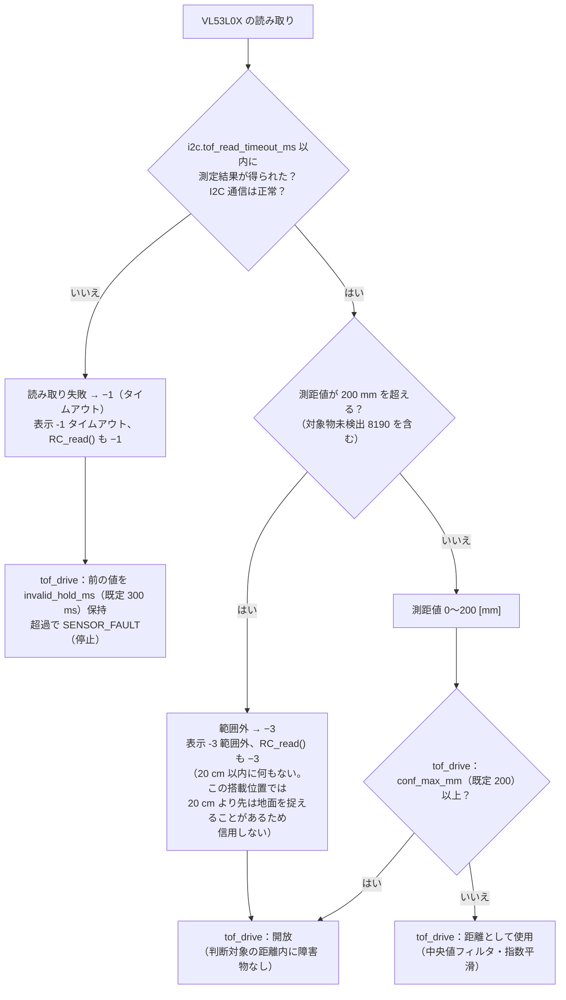

タイトル（ウィンドウと画面左上）にアプリの版を表示します。その隣に **PC の Wi-Fi**（この PC が現在接続しているネットワークの名前）を表示します。車への接続時のネットワーク（通常 `RumiCar`）から外れると赤色で表示し、ログにも記録します。Windows はインターネットに接続できないアクセスポイントから、自動で別のネットワークへ切り替えることがあるため、通信が突然切れた場合はまずこの表示を確認してください（10 章）。Windows 11 24H2 以降でネットワーク名を取得できない場合は、Windows の 設定 → プライバシーとセキュリティ → 位置情報 →「デスクトップ アプリに位置情報へのアクセスを許可する」をオンにします（Windows がネットワーク名を位置情報として扱うため）。

### 手動操作

「手動」を押すと、走行カードの**操縦パッド**、マウス・タッチパッドのスクロール、矢印キーで操作できます。操舵は左／中央／右の 3 状態（操舵モーターのオン・オフ）、駆動は `RC_drive` の値 0〜255（PWM のデューティ、1 刻み）です。パッドの座標は中心を原点に、端を ±1 として扱います。

| 操作 | 操舵 | 駆動 |
|---|---|---|
| **パッドを押したままドラッグ**（マウスの左ボタン、タッチパッドはクリックしたまま、または「タップしてドラッグ」） | 横位置 \|x\| ≥ 0.33（左右の 1/3）で左／右、\|x\| < 0.22 で中央に戻る（ヒステリシス） | 上半分 = 前進、下半分 = 後退。\|y\| ≤ 0.12 は停止、そこから端まで「最大出力」に向かって線形に増加。**離すと停止** |
| **上下スクロール**（ホイール、タッチパッドの 2 本指上下。パッドまたは画像の上） | — | 設定速度を変更し、**その速度で走行を継続**。ホイール 1 ノッチで 13（約 5%）。前進から後退（またはその逆）へは 0 で一度停止し、0.4 秒操作を止めてから再度スクロールすると反対方向に入ります |
| **左右スクロール**（2 本指で左右、チルトホイール、Shift ＋ ホイール） | スクロール中のみ左／右、最後のスクロールから 0.25 秒で中央 | — |
| **矢印キー** | ← → 押下中 | ↑ ↓ 押下中は「最大出力」で前進／後退 |
| **停止** | Space、パッドの右クリック・中クリック、「停止」ボタン。ウィンドウが非アクティブになったとき（別のアプリに切り替えたとき）も停止 | |

優先順位は、パッド押下中はパッド、それ以外は押下中のキー、それ以外はスクロールです（← → キーとスクロールの設定速度は併用可：スクロールで一定速度を設定し、← → で操舵）。パッドまたは ↑ ↓ を押すとスクロールの設定速度は 0 にリセットされるため、離した後に以前の速度で走行を再開することはありません。「最大出力」（既定 153 = 約 60%）は 3 種類の操作すべての上限で、さらに車の設定 `max_drive_pwm` で制限されます。タッチパッドの設定によって左右が逆になる場合は「左右スクロールの向きを反転」をオンにします。

手動モードで heartbeat が 1 秒途絶えると、車は非常停止します（5 章の表）。

切断するには「切断」を押します。自動モードでは、アプリを終了しても車は走行を継続します（PC 無しで走行できる設計）。停止させるには非常停止を押すか、車の電源を切ります。

## 6. 走行データの収録と判断データの改良

### 6.1 収録

接続時に自動で（自動収録をオフにした場合は「収録開始」で）、保存先の下に収録 1 回ごとのフォルダを作成します。

```
RumiCarData/
  sessions/
    RumiCar_20261018-123456/      車の名前_開始時刻（UTC）
      frames/000001.jpg …        画像（番号は収録内の通し番号）
      meta.jsonl                 1 行 1 フレーム：{"index":1,"image":"000001.jpg","received":"…","header":{…車から受信した状態…}}
      session.json               収録の概要（シナリオ、メモ、開始時に車が使用していたロジック／パックとその説明・対応機能・学習元、フレーム数、画像枚数、欠落回数、低電圧の有無）
  scenarios.json                 使用したシナリオ名の一覧（新しい順、使用回数付き）
```

`header` には、そのフレームの ToF 値、ロジックの状態と判断（操舵・駆動）、実際にモーターへ出力した値、走行モード、非常停止、ロジックとパックの名前と版（`logic_name`／`pack_id`）、電源の状態（`throttled`）、画像の連番と時刻が含まれます。

**シナリオの付け方**：収録前に「シナリオ」欄に場面の名前を入力します。「壁のみの走行データ」「信号機ありケース1」「信号機と交差点ロジックあり」のように、判断データの作成時にどの収録を使うか選択できる名前にします。使用済みの名前は `scenarios.json` から選択できます。

### 6.2 Claude のデスクトップアプリによる改良

1. Claude のデスクトップアプリで `RumiCarData` フォルダ（またはその中の `sessions`）を開き、収録を参照させて改良を指示します。
2. 走行ロジック `tof_drive` が使う判断データは、パラメータファイル `params.json` 1 つです。キーの意味と既定値は仕様書 3.7 にあります（例：`d_turn_enter_mm` 旋回を開始する前方距離、`v_max` 最高速（`RC_drive` の値 0〜255）、`accel_pwm_per_s` 加速時の変化率）。距離は `RC_read` の値（0〜200 mm。−3 は開放）です。
3. 作成したデータは、次の構成のフォルダにします（manifest.json は `car/tools/make_manifest.py` で作成できます。Python 3 の標準ライブラリのみで動作）。

```
base-tof-0.2.0/            フォルダ名は <id>-<version>
  params.json              全キー必須
  manifest.json            python car/tools/make_manifest.py pack base-tof-0.2.0 --id base-tof --version 0.2.0 --logic tof_drive \
                               --description "壁のみ。旋回を早めに開始するよう d_turn_enter_mm を 180 に" \
                               --capability walls --scenario "壁のみの走行データ" --parent base-tof-0.2.0
```

版（`0.2.0` など）には、車にインストール済みの版と重複しない新しい番号を付けます。

`--description`（版の説明）、`--capability`（対応する場面：`walls` 壁、`traffic_light` 信号機、`vehicle` 車両、`intersection` 交差点。複数指定可）、`--scenario`（作成に使用した収録シナリオ。複数指定可）、`--parent`（元にした版）は任意ですが、指定すると走行管理アプリの「判断データ」「対応機能」「学習元」と版の一覧に表示され、使用中のロジック／データを識別できます。`python car/tools/make_manifest.py show <フォルダ>` で確認できます。

### 6.3 車への送信と切り替え

1. 走行管理アプリで車に接続し、「版の管理」の **「送る…」** でそのフォルダを選択します。アプリは manifest を検証してから送信します。
2. 一覧に新しい版が表示されたら、それを選択して **「有効化」** を押します。車は検証後、次のフレームで切り替えます（走行中も可）。検証に失敗した場合は現行版のまま走行を継続し、ログに理由を記録します。
3. 問題があれば **「データを戻す」** で直前の版に戻します。不要な版は選択して「削除」します（使用中と直前の版は削除不可）。

ロジック本体（`tof_drive` の .so）を再ビルドした場合も同じ手順で送信できます（`make_manifest.py logic …`、仕様書 4 章）。

### 6.4 収録からの動画作成

走行管理アプリの「動画を作る…」で収録フォルダを選択すると、`frames/` の画像から `video.avi` を作成します（Motion JPEG：受信した JPEG を再圧縮せずに格納するため画質は劣化しません。20 フレーム/秒、画像の時刻に基づく実時間。フレームが欠落した区間は直前のフレームを最大 1 秒保持し、それを超える空白は詰めます）。VLC、Windows のメディア プレーヤー、ffmpeg で再生できます。Claude のデスクトップアプリから作成する場合は、同じ処理の `python car/tools/session_video.py <収録フォルダ>` を使用します（Python 3 の標準ライブラリのみで動作）。MP4 に変換する場合は `ffmpeg -i video.avi -c:v libx264 -pix_fmt yuv420p video.mp4`。

## 7. 画像による学習（信号機・前方車両・交差点）

### 7.1 仕組み

車は ToF（距離センサー）による走行を基盤としたまま、カメラ画像を特徴量に変換し（320×240 を 1/5 に縮小して 8×6 のセルに分割し、セルごとに 8 つの色区分（6 色相と明・暗）の画素数と、明度・彩度・明度勾配（横・縦）の総和を集計した 576 個の整数）、**収録データから学習した検出器**を適用します。検出器には、画像内の位置を出力する**局所検出器**（赤信号・青信号・車両。3×3 セルの窓で評価）と、画像全体の状態を出力する**全体検出器**（前方に交差点がある、など）の 2 種類があります。検出結果に基づき、3 つの挙動が ToF の走行に「速度の上限」と「操舵モード」を与えます。

**図 4** 特徴量の算出と検出器

<!-- figure: ja/04-features.mmd -->
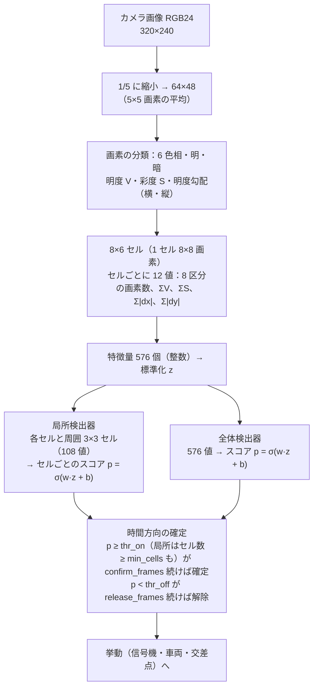

| 挙動 | 使用する検出器 | 動作 |
|---|---|---|
| 信号機 `signal` | 赤信号・青信号（局所） | 赤信号の検出が所定のフレーム数続くと減速し、接近すると停止。青信号を検出する（または赤信号が検出されなくなってから所定時間が経過する）と発進 |
| 車両 `vehicle` | 車両（局所） | 自車線（画像の中央の列）に車両を検出すると、旋回せずに車間距離を保って追従。停止したまま車間が変化しなければ「駐車車両」と判定し、左右の ToF で余裕のある側から追い越す（追い越し側へ進路変更 → 並走 → 元の車線へ復帰） |
| 交差点 `intersection` | 交差点（全体。左に道がある／右に道がある） | 交差点を検出すると減速し、左右の壁の切れ目を左右の ToF（前方 65° 向き）が捉えた（−3 になった）位置＝自車の前端が交差点の角の手前に来た位置で停止し、設定に従って直進・左折・右折 |

3 つの挙動は独立に動作し、重なった場合は**最も低い速度の上限**が適用されます。追い越しや右左折の途中で赤信号を検出した場合は、その操作を中止して停止します。障害物に対する非常ブレーキ・後退・センサー異常は、常に ToF の判断が優先します（画像による判断は ToF の判断に制約を追加するだけで、ToF の安全側の動作を無効にすることはありません）。

学習結果は「判断データ（パック）」です。内容は `params.json`（ToF と各挙動のパラメータ、テキスト形式）、`vision.bin`（検出器の重みなど。車が高速に読み込める二進形式）、`manifest.json`（説明・対応機能・学習元）で、6 章と同じ手順で車に送信して切り替えます。走行ロジック `cam_drive` は車に同梱されています（`tof_drive` と並んでインストール済み）。使用する検出器が無い挙動は自動的に無効になるため、最初は信号機のみ、次に車両、と段階的に機能を追加できます。

### 7.2 必要な環境

- Python 3 と numpy、Pillow（`pip install numpy pillow`）。Claude のデスクトップアプリで作業する場合はその環境に、手元で実行する場合は PC にインストールします
- このリポジトリの `car/tools/`（`train_pack.py`、`rumicar_vision.py`、`make_manifest.py`、`session_video.py`）
- 任意：`rumicar-replay`（GitHub Actions の成果物 `rumicar-replay-amd64`。収録を実際のロジックで再生し、送信前に停止・発進の判断を確認できます）

### 7.3 手順

**図 5** 学習から車への反映までの流れ

<!-- figure: ja/05-learning.mmd -->
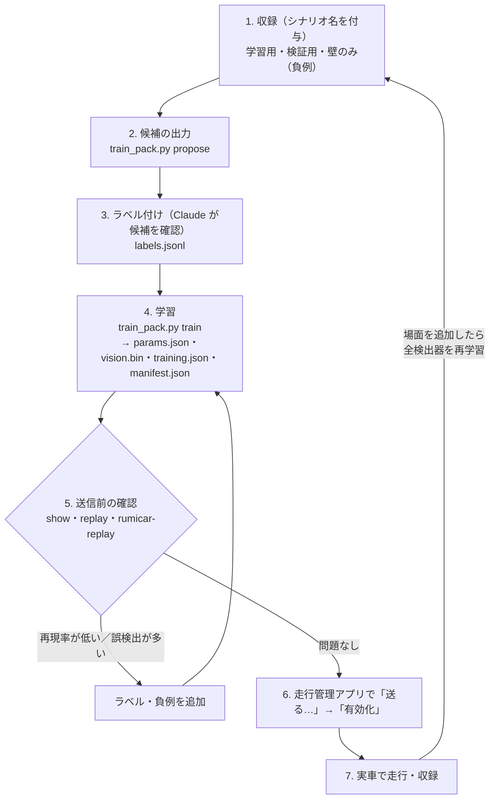

1. **収録**：信号機を設置したコースを走行させ（発進前に赤・青を撮影する場合は「収録のみ」で車を手で動かしても可）、シナリオ名を「信号機ありケース1」などとして収録します。信号機の無いコースの収録（「壁のみの走行データ」）は「信号機が写っていない例」（負例）として自動的に使用されるため、こちらも用意します。学習用と検証用に、別々の収録を 2 回以上行います。
2. **ラベル付け**：`python car/tools/train_pack.py propose <収録フォルダ> --detector traffic_light_red` が、赤色領域の位置（フレーム番号と矩形）を候補として `proposals_traffic_light_red.jsonl` に出力します。Claude にそのフォルダを参照させ、候補のフレーム（`frames/` の画像）を確認させて、正しいものを `labels.jsonl` に記述させます。青信号も同様です（`--detector traffic_light_green`）。候補の行は `labels.jsonl` の行と同じ形式で、余分なキー（`image`、`pixels` など、候補とした根拠の情報）は無視されるため、不要な行を削除して貼り付ければ使用できます。形式は次のとおりです（1 行 1 件、矩形は画素座標 [x0, y0, x1, y1]、x1/y1 は範囲に含まない）。

```
{"index": 123, "objects": [{"name": "traffic_light_red", "box": [160, 60, 200, 110]}]}   ← 局所（矩形）
{"index": 456, "objects": [{"name": "vehicle", "box": [120, 140, 200, 220]}]}            ← 前方車両（車体を囲む）
{"from": 300, "to": 380, "scene": ["intersection_left"]}                                 ← 場面（画像全体）：300〜380 フレームは前方に左へ分岐する交差点がある
{"index": 200, "negative": true}                                                         ← 対象物が写っていないことを明示
```

   車両の候補は `--detector vehicle` で出力します（ToF 中央の値が近かったフレーム。矩形は車線の位置を示すだけなので、車体に合わせて修正します）。交差点の候補は `--detector intersection_left`（または `_right`）で出力します。左右の ToF（前方 65° 向き）が「壁あり」から「開放（−3）」に変化した時点＝自車の前端が交差点の角の手前に来た時点から逆算し、その前 2 秒（`--before-ms`）を「前方に交差点が見えていた区間」として提示します。区間の最初と最後のフレームを確認し、区間を調整します。ラベルの無いフレームは学習に使用しません。20 フレームに 1 枚程度を確認すれば十分です（特徴が類似する区間のフレームは `propose` の候補で補完されます）。ラベルを付けたフレームは、そのラベルに含まれない検出器にとっての負例になります（車両の赤いテールランプは赤信号ではない、という学習はこの仕組みによります）。

3. **学習**：

```
python car/tools/train_pack.py train cam-signal-0.1.0 \
    --parent <車から取得した cam-base-0.2.0 のフォルダ、または前の版> \
    --sessions <学習用の収録>... --validate <検証用の収録>... \
    --negatives-from-scenario "壁のみの走行データ" \
    --detector traffic_light_red --detector traffic_light_green \
    --id cam-signal --version 0.1.0 --description "信号機ありケース1"
```

   `cam-base-0.2.0` はリポジトリの `car/packs/cam-base` にもあります。完了すると `cam-signal-0.1.0/` に `params.json`・`vision.bin`・`training.json`（学習の記録）・`manifest.json` が作成され、検証用の収録に対する検出の適合率・再現率が表示されます。再現率が低ければラベルを追加し、誤検出が多ければ負例（壁のみ）を追加します。車両と交差点を追加する場合は、検出器を並べて一度に学習します（`:global` は全体検出器）。

```
python car/tools/train_pack.py train cam-town-0.1.0 --parent cam-signal-0.1.0 \
    --sessions <信号機の収録> <車両と交差点の収録>... --validate <検証用>... \
    --negatives-from-scenario "壁のみの走行データ" \
    --detector traffic_light_red --detector traffic_light_green \
    --detector vehicle --detector intersection_left:global --detector intersection_right:global \
    --intersection turn=left --id cam-town --version 0.1.0 --description "信号機と交差点ロジックあり"
```

   各挙動の設定は、対応する検出器がパックにある場合のみ `params.json` に追加されます（`behaviours on: signal, vehicle, intersection` と表示されます）。片側の交差点のみを学習した場合、もう片側の検出器名は空（その側の交差点は無いものとして扱う）になります。

4. **送信前の確認**：`python car/tools/train_pack.py show cam-signal-0.1.0`（内容と、有効な挙動）、`replay cam-signal-0.1.0 <収録>`（フレームごとの検出結果）、`rumicar-replay <cam_drive のフォルダ> cam-signal-0.1.0 <収録>`（実際のロジックで再生。状態が CRUISE → SIGNAL_APPROACH → SIGNAL_STOP → SIGNAL_RESUME の順に遷移すれば、停止と発進が機能しています。車両は FOLLOW → OVERTAKE_OUT → OVERTAKE_PASS → OVERTAKE_IN、交差点は INTERSECTION_APPROACH → INTERSECTION_STOP → (INTERSECTION_CROSS →) INTERSECTION_TURN）。再生は収録時の ToF の値をそのまま入力するため、追い越しのように「車の動きの結果として ToF の値が変わる」場面は収録どおりにしか進みません（確認できるのは停止・減速・進路変更の開始までです）。
5. **車への送信**：走行管理アプリの「版の管理」で `cam_drive-0.2.0`（同梱）を選択して「有効化」し、「送る…」で `cam-signal-0.1.0` を送信して「有効化」します。状態欄の「判断データ」「対応機能」「学習元」に、送信した版の説明・「壁 / 信号機」・学習に使用した収録のシナリオが表示されます。「判断を重ねる」をオンにすると、画像の上に検出枠（赤信号 = 赤、青信号 = 緑、車両 = 水色、交差点 = 橙で画像全体を囲む。確定すると太枠）とスコアが描画されます。「判断状態」には `FOLLOW（前方車両に追従）` のように状態の意味も表示されます。
6. **改良**：収録を追加し、`--parent cam-signal-0.1.0 --version 0.2.0` で再学習します。新しい場面（車両、交差点）の収録を追加した場合は、既存の検出器を含めて**全検出器を再学習する**のが原則です（新しい場面が既存の検出器の負例になるため。例：車両のテールランプを赤信号と誤検出しない）。`--keep-parent-detectors` は、場面を追加せずに一部の検出器だけを修正する場合に使用します（manifest の `parent` に系譜が残ります）。

### 7.4 信号機の挙動の設定（params.json の signal）

| キー | 既定 | 意味 |
|---|---|---|
| `red_detector` / `green_detector` | `traffic_light_red` / `traffic_light_green` | 使用する検出器の名前。青信号の無いコースでは `green_detector` を `""` にし、`resume_without_green_ms` で発進させます |
| `stop_min_cells` | 2 | 赤信号がこのセル数以上で検出されたら「近い」と判定して停止（それまでは減速のみ） |
| `approach_v` | 128 | 赤信号の検出から停止までの速度の上限（`RC_drive` の値 0〜255） |
| `min_stop_ms` | 1000 | 最低停止時間 |
| `resume_without_green_ms` | 3000 | 赤信号が検出されなくなってから発進するまでの時間（0 = 青信号を検出するまで待機） |
| `resume_ignore_ms` | 1500 | 発進後、赤信号の検出を無視する時間（通過中に再停止しないため） |

`train` の `--signal キー=値` で変更できます（例 `--signal stop_min_cells=3`）。

**図 6** 信号機の挙動の状態遷移

<!-- figure: ja/06-signal.mmd -->
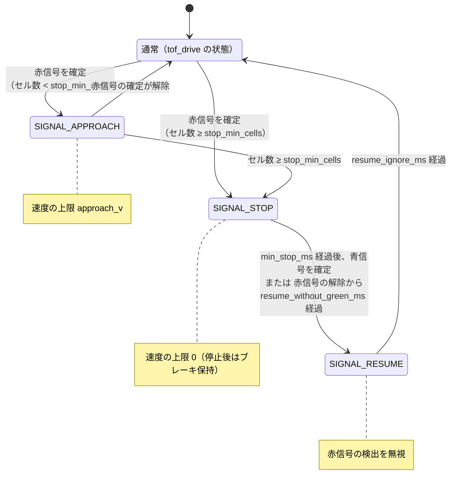

### 7.5 前方車両の挙動の設定（params.json の vehicle）

この節（`vehicle`）が `params.json` に無ければ挙動は無効です。ある場合は全キーが必須です（`train` が検出器 `vehicle` を含むパックに自動で追加します。`--vehicle キー=値` で変更）。距離はすべて `tof_drive` の処理後の値で、`tof.conf_max_mm` 以上の読みと −3（20 cm 以内に何もない）は「開放」として扱います。

| キー | 既定 | 意味 |
|---|---|---|
| `detector` | `vehicle` | 使用する局所検出器の名前 |
| `lane_cols` | 4 | 検出した車両の最良セル（スコア最大のセル）が格子の中央のこの列数（8 列なら 2〜5 列目）にある場合のみ「自車線」と判定 |
| `follow_gap_mm` | 150 | 前方車両との最小車間（ToF 中央）。これ以下で速度の上限を 0（停止）。`tof.d_emergency_mm` より大きく、`tof.conf_max_mm` より小さいこと |
| `follow_band_mm` | 40 | 車間が `follow_gap_mm` からこの幅だけ広がるまでの区間で、上限を 0 から `follow_v` まで線形に上げる（`follow_gap_mm` + `follow_band_mm` は `tof.conf_max_mm` 以下。ToF は 200 mm までしか返さないため） |
| `follow_v` | 179 | 追従中の速度の上限（`RC_drive` の値 0〜255）。車両がカメラでのみ検出され、ToF ではまだ検出されていない間もこの上限 |
| `parked_confirm_ms` | 2000 | 車両の後方で停止したまま、車間が広がらずにこの時間が経過したら「駐車車両」と判定 |
| `still_delta_mm` | 20 | 待機中に車間がこれより広がったら「発進した」と判定して判定をやり直す |
| `overtake_side` | `open` | 追い越す側。`left`／`right`／`open`（左右の ToF で距離の大きい側。同じなら右） |
| `side_clear_mm` | 120 | その側の ToF がこれ以上（または開放）なら追い越し可。不可なら `FOLLOW_WAIT` で待機 |
| `overtake_v` | 128 | 追い越し中の速度の上限 |
| `out_ms` | 500 | 追い越し側へ進路変更する時間（追い越し側へ最大舵角） |
| `pass_min_ms` / `pass_max_ms` | 800 / 3000 | 並走（操舵を中立に戻して直進）する時間の最短／最長 |
| `pass_clear_mm` / `pass_clear_ms` | 150 / 700 | 内側（車両のある側）の ToF が一度これ未満（車両を検出）になった後、これ以上（または −3）の状態がこの時間続いたら「通過完了」と判定。左右の ToF は前方 65° を向いているため、車両が見えなくなるのは自車の前端が車両の前端付近に来た時点で、残りの車体が車両の横を抜けるまでの時間をこの値で持たせる（仮の値。実車で確認して調整） |
| `in_ms` | 500 | 元の車線へ復帰する時間（反対側へ最大舵角） |
| `ignore_ms` | 1500 | 追い越し完了後、車両の検出を無視する時間。また、追従中にカメラが車両を検出できない状態がこの時間続くと追従を終了し、ToF の判断に戻す（車両に近すぎて検出できない場合は、ToF が障害物として回避する） |

追い越しは時間で区切った開ループ制御です（操舵が左／中央／右の 3 状態のみのため）。進路変更・復帰の時間は、コースと車速に合わせて調整してください。

**図 7** 前方車両の挙動の状態遷移

<!-- figure: ja/07-vehicle.mmd -->
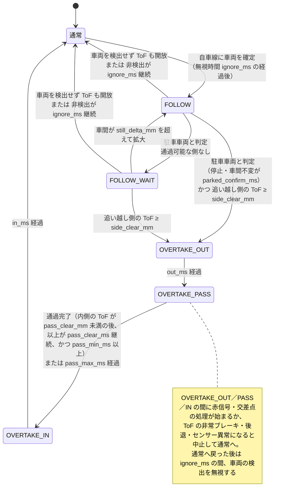

### 7.6 交差点の挙動の設定（params.json の intersection）

この節（`intersection`）が無ければ無効です。ある場合は全キーが必須です（`train` が検出器 `intersection_left`／`intersection_right` のいずれかを含むパックに自動で追加します。`--intersection キー=値` で変更）。

| キー | 既定 | 意味 |
|---|---|---|
| `left_detector` / `right_detector` | `intersection_left` / `intersection_right` | 左へ分岐する交差点／右へ分岐する交差点の検出器（全体）。片方は `""` でも可（両方は不可） |
| `approach_v` | 128 | 交差点の検出から停止までの速度の上限 |
| `stop_trigger` | `side_open` | 停止の条件。`side_open` = 左右いずれかの ToF が `open_mm` 以上または −3（壁が途切れた）になったとき。`detector` = 検出器が確定した時点で即停止（壁の無いコースで、交差点の直前の画像だけを学習させた場合） |
| `open_mm` | 200 | 左右の ToF（前方 65° 向き）がこれ以上（または −3）なら「開いた」と判定（最大 200。200 なら −3 のみ） |
| `stop_ms` | 1000 | 停止時間（赤信号の検出中は、青信号になるまで発進しない） |
| `turn` | `straight` | 停止後の進路。`straight` 直進／`left`／`right`／`detector`（検出した側へ曲がる。両側を検出した場合は直進） |
| `turn_v` | 128 | 直進しながら曲がる側の開放を待つ間と、右左折中の速度の上限 |
| `cross_max_ms` | 2000 | 曲がる側の ToF が開放になるまで直進して待つ最長時間（開放にならなければ直進で終了） |
| `turn_ms` | 900 | 曲がる側へ最大舵角で操舵する時間 |
| `ignore_ms` | 3000 | 終了後、交差点の検出を無視する時間 |

**図 8** 交差点の挙動の状態遷移

<!-- figure: ja/08-intersection.mmd -->
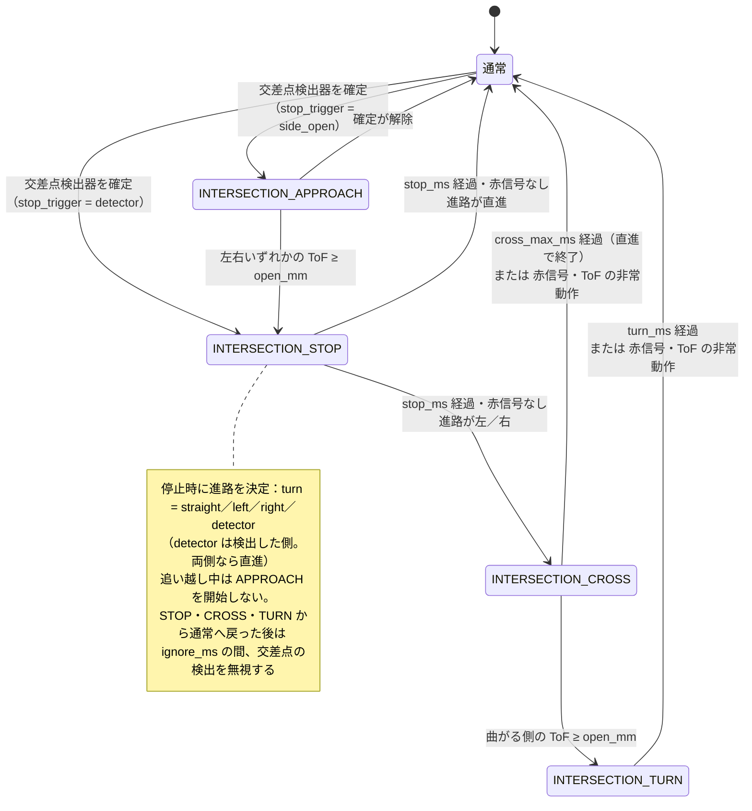

### 7.7 挙動の組み合わせ

- 速度の上限は 3 つの挙動の最小値です。追従中に赤信号を検出すれば `SIGNAL_STOP`、交差点に到達すれば `INTERSECTION_STOP` で停止します。
- 「駐車車両」の判定は、赤信号・交差点の処理中は進行しません（信号待ちの車両を追い越さないため）。追い越しの途中で赤信号または交差点を検出した場合は操作を中止して停止し、その後は追従からやり直します。
- 交差点での停止中は、赤信号が検出されなくなる（青信号になる）まで発進せず、直進・右左折の途中で赤信号を検出すれば操作を中止します。
- 「判断状態」に表示される状態は、速度と操舵を決定している挙動のものです：赤信号（`SIGNAL_APPROACH`／`SIGNAL_STOP`）→ 交差点 → 車両 → 発進中（`SIGNAL_RESUME`）の優先順。ToF の非常ブレーキ・後退・センサー異常の間はその状態を表示します。

### 7.8 トラブルシューティング

| 症状 | 対処 |
|---|---|
| 赤信号以外の物体で停止する | 「壁のみ」の収録や、その物体が写った収録を負例として追加する。`training.json` の精度を確認する。`--thr-on` を上げる |
| 停止位置が遠い／近い | `stop_min_cells` を増やす／減らす。カメラの取り付け角度が収録時と同じか確認する |
| 停止したまま発進しない | 青信号の検出器が青信号を検出しているか（「検出」欄）確認する。検出しない場合は `resume_without_green_ms` を設定する |
| 車両の後方で停止せず回避する | 「判断を重ねる」で車両の枠が中央の列（`lane_cols`）に表示されているか確認する。接近すると車体が大きく写って検出できなくなる場合は、近距離の収録にラベルを追加する。`follow_gap_mm` を上げる |
| 追い越し中に接触する／大回りする | `out_ms`・`in_ms`・`overtake_v` を調整する。追い越し側の壁が近い場合は `side_clear_mm` を上げる（その側では待機する） |
| 駐車車両を追い越さない | 「判断状態」が `FOLLOW_WAIT` なら両側とも `side_clear_mm` 未満。`FOLLOW` のままなら車両の検出が途切れている（上の行）か、赤信号・交差点の処理中 |
| 交差点で停止しない | `replay` で `intersection_*` が確定しているか確認する。確定しており壁のあるコースなら、`open_mm` が壁までの距離より小さいか確認する。壁の無いコースでは `stop_trigger` を `detector` にする |
| 交差点で曲がらない | `cross_max_ms` 以内に曲がる側の ToF が開放（`open_mm` 以上）になっていない。`turn=detector` で両側を検出した場合は直進になる |
| 送信した版が「検証失敗」になる | `make_manifest.py verify` を実行する。`vision.bin` の自己診断が一致しない場合は、カメラの設定（320×240）が学習時と異なる。学習ツールと車の版の対応（ABI 2）を確認する |
| `rumicar-replay` と車で結果が異なる | 収録は JPEG、車は非圧縮画像を使うため、わずかな差は生じます。差が大きい場合は照明条件が変わっている可能性があるため、その照明条件で収録を追加する |
| 検出が確定したまま解除されない | `show` で `thr` の 2 つ目（解除のしきい値）が「対象物が無いときのスコア」より高いか確認する。`train` は負例のスコアの上位 1% より上に設定しますが、`--hysteresis` を小さくして再学習すると上がります |

## 8. SSH による車へのログイン

```sh
ssh rumicar@10.42.0.1          # パスワード rumicar
sudo journalctl -u rumicar-core -f     # 本体のログ（状態遷移、切り替え、エラー）
systemctl status rumicar-core          # サービスの状態
rumicar-activate show                  # 使用中／直前の版と、最後の切り替え結果
sudo nano /etc/rumicar/core.json       # 設定（変更後は sudo systemctl restart rumicar-core）
```

主な設定（`/etc/rumicar/core.json`、仕様書 3.3）：`car_name`（車の名前）、`startup_mode`（起動時の走行モード：`record_only` 既定／`auto` 電源投入と同時に走行）、`max_drive_pwm`（駆動の上限。`RC_drive` の値で 255 = 100%）、`auto_accel_pwm_per_s`（自動モードへの切り替え時の駆動許容値の増加率。既定 287 で 0 から 255 まで約 0.89 秒。0 で制限なし）、`camera.enabled`、`camera.on_demand`（PC 接続中または自動モードのときのみカメラを動作させる。既定 true）、`camera.fps`、`network.heartbeat_timeout_ms`、`network.ap_start`（アクセスポイントを `core` が起動する（既定）か、`boot` で NetworkManager に任せるか）、`network.wifi_txpower_dbm`（無線の送信出力の上限。0 = ドライバの既定値。電池の電圧低下が問題になる場合は 10〜14 程度を試す）、`power.throttled_path`（低電圧・処理速度制限の監視。空文字で無効）。

## 9. 更新

### 9.1 イメージ全体の更新

新しい Release のイメージを SD カードに書き込み直します。走行管理アプリの「SD カードを作る…」（5 章）で版を選ぶと、ダウンロード・検証・Imager の起動までを行います（2 章の手順を手で行っても同じです）。収録データは PC 側にあるため失われません。車に送った判断データ・自分の走行プログラム・`core.json` やアクセスポイントの設定変更は消えて同梱の状態に戻るので、必要なものは書き込み後に PC 側のフォルダから送り直します。

### 9.2 パッケージのみの更新

Release の `rumicar-zero2cam_<版>_arm64.deb` を車に転送してインストールします（走行中にインストールすると、本体の再起動に伴いモーターが一度停止します）。

```sh
scp rumicar-zero2cam_<版>_arm64.deb rumicar@10.42.0.1:
ssh rumicar@10.42.0.1
sudo apt install ./rumicar-zero2cam_<版>_arm64.deb
```

必要なライブラリはイメージに含まれているため、インターネット接続は不要です。`/etc/rumicar/core.json` やアクセスポイントの設定ファイルを変更していた場合は、置き換えるかを確認されます（変更していなければ確認なしで更新されます）。同梱のロジック／パックは、同じ版のディレクトリが車に既にあれば上書きされません（新しい版のみ追加されます）。

### 9.3 車をインターネットに接続する必要がある場合

車は通常アクセスポイントとして動作し、外部ネットワークには接続しません。`apt` でパッケージを追加する場合は、一時的に家庭の Wi-Fi に接続を切り替えます（切り替えると `RumiCar` のアクセスポイントは停止します。再起動で元に戻ります）。

```sh
sudo nmcli device wifi connect "<家庭のSSID>" password "<パスワード>"
```

### 9.4 版番号の体系

版番号は 3 種類あり、それぞれ独立に更新します。

| 種類 | 例 | 対象・表示箇所 |
|---|---|---|
| 本体（製品）の版 | `v0.4.1` | Release のタグ。SD カードイメージ・`.deb`・走行管理アプリ・車の `core_version` が同じ番号。接続時のログの `本体 <版>, このアプリ <版>`、アプリのタイトル |
| ロジックの版 | `tof_drive-0.3.0`、`cam_drive-0.3.0` | ロジックごとの番号（`car/CMakeLists.txt` の `TOF_DRIVE_VERSION`／`CAM_DRIVE_VERSION`／`PY_DRIVE_VERSION`、manifest の `version`）。「版の管理」の一覧と状態欄の「版（ロジック／データ）」 |
| 判断データ（パック）の版 | `base-tof-0.2.0`、`cam-base-0.2.0`、自分で作成した `cam-signal-0.1.0` | パックごとの `manifest.json` の `version`。自分で学習させた版には、車にインストール済みの版と重複しない番号を付けます（7 章） |

本体 0.4.1 の Release の同梱は `tof_drive-0.3.0`・`cam_drive-0.3.0`・`py_drive-0.2.0`・`base-tof-0.2.0`・`cam-base-0.2.0`・`py-sample-0.2.0` です。本体とロジックの番号が一致していても、両者は独立した番号です。

**Release ではないビルド**（GitHub Actions がタグ以外で作成した `.deb`・SD カードイメージ・アプリ）は、版の後ろに `+g` と commit の先頭 7 文字が付きます（例 `0.2.1+g1a2b3c4`）。タグの付いた Release のものと区別するためです。Debian の版の比較では `0.2.1` ＜ `0.2.1+g1a2b3c4` ＜ `0.2.2` です。車の本体とアプリの版の数値部分（`+` より前）が異なる場合は、接続時のログに警告を記録します。

## 10. トラブルシューティング

| 症状 | 確認事項 |
|---|---|
| Wi-Fi に `RumiCar` が表示されない | 起動後 1〜2 分待つ。SSH が使用可能なら、`nmcli connection show` に `RumiCar-AP` があるか、`sudo journalctl -u NetworkManager -b` にエラーが無いか、`iw reg get` が `JP` か確認する |
| アプリが接続できない | PC が `RumiCar` に接続し `10.42.0.x` のアドレスを取得しているか（`ipconfig`）。ファイアウォールの許可。車で `systemctl status rumicar-core` |
| 画像が表示されない | 車で `sudo journalctl -u rumicar-core -b | grep -i camera`。カメラケーブルの向き。`rpicam-hello --list-cameras` でカメラが認識されているか |
| 走行しない | 起動直後は「収録のみ」で待機しています（アプリで「自動」を押す。PC 無しで走行させる場合は `startup_mode` を `auto` に）。`sudo journalctl -u rumicar-core -b` の先頭に `hardware bring-up failed` が無いか（I2C／PWM の設定は `/boot/firmware/config.txt` の末尾に追記済み）。非常停止が作動していないか（アプリの「非常停止解除」）。ToF の値が `-1 タイムアウト`（読み取り失敗）の状態が `invalid_hold_ms`（既定 300 ms）を超えて続くと SENSOR_FAULT で停止します（`-3 範囲外` は正常な値です） |
| 起動途中で電源が遮断される・再起動する（乾電池） | 起動時に消費電流の大きい機能（Wi-Fi、カメラ、モーター）が同時に動作しないよう、v0.1.3 以降はセンサー → Wi-Fi → カメラの順に起動し、モーターは「自動」が選択されるまで停止しています。それでも発生する場合は、電池を新品か充電式（ニッケル水素）に交換する、`network.wifi_txpower_dbm` を 10 程度にして無線の送信出力を下げる、アプリの「電源」欄に「低電圧」が表示されていないか確認する（表示される機種であれば原因の切り分けに使用できます）。走行中に発生する場合は `max_drive_pwm` を下げて加速時の電流を抑えます |
| Wi-Fi が途中で消えた | 本体（rumicar-core）が停止するとアクセスポイントも起動しませんが、`rumicar-ap.timer` が起動 90 秒後から 60 秒ごとに再起動を試みます。`systemctl status rumicar-ap.timer` と `nmcli connection show --active` で確認します |
| PC が `RumiCar` から自動で切断される | 車のアクセスポイントはインターネットに接続できないため、Windows が「インターネット接続なし」と判断し、登録済みの別の Wi-Fi に切り替えることがあります。アプリの「PC の Wi-Fi」が赤色になった場合はこれに該当します。対策：Windows の Wi-Fi 設定で `RumiCar` を「自動的に接続」にし、ほかのネットワーク（自宅や職場の Wi-Fi）の「自動的に接続」を走行中のみオフにする。または、ほかのネットワークの電波が届かない場所で走行させる。有線 LAN でインターネットに接続している PC では、Wi-Fi を車専用にできます |
| 自動モードへの切り替え直後に急発進する | v0.3.0 以降、自動モードへの切り替え時は駆動の許容値を 0 から増加させます（`auto_accel_pwm_per_s`、既定 287 で 0 から 255 まで約 0.89 秒）。速すぎる場合はアプリの「自動の最大出力」を下げます（本体の再起動で戻ります。初回の走行は 77〜128 から）。常に制限する場合は車の `max_drive_pwm` |
| 自作のプログラムが動作しない | 読み込み時のエラーはアプリのログに理由（`drive.py の N 行目 …`）が記録されます。走行開始後のエラーと `print()` の出力は車のログ（`sudo journalctl -u rumicar-core -f`）に記録されます。`loop()` は 1 フレームあたり 30 ms 以内に完了しなければそのフレームはブレーキになり、1 秒以上応答が無いとプログラムを停止します（`time.sleep()` や無限ループは使用不可）。11 章 |
| `hardware bring-up failed: open /dev/i2c-1` | v0.1.1 のイメージにはカーネルモジュール `i2c-dev` を読み込む設定が無く、`/dev/i2c-1` が作成されませんでした。`sudo raspi-config` → Interface Options → I2C → Yes で解消します（再起動後も有効）。v0.1.2 以降のイメージとパッケージでは不要です |
| 切り替えに失敗する | アプリのログに記録された理由（manifest の不一致、必須キーの不足、ロジック名の不一致など）。車で `rumicar-activate show` |
| SSH のパスワードが通らない | 初回起動の設定が反映される前の可能性があります。再起動して数分待ちます |

アプリのログ欄の内容か `sudo journalctl -u rumicar-core -b` の出力を添えて [Issues](https://github.com/RumiCar-group/RumiCar-Zero2Cam/issues) に投稿してください。

## 11. 自作の走行プログラム（Python）

同梱の走行ロジック（`tof_drive`、`cam_drive`）のほかに、**利用者が作成した Python プログラム**で車を走行させることができます。ロジック `py_drive` が、送信されたパックの `drive.py` を車上で実行します。学習の仕組み（7 章）とは独立した機能で、「距離センサーの値から操舵と駆動を決定する」処理を利用者自身が記述するためのものです。コンパイラや開発環境は不要です。テキストエディタ（メモ帳でも可）と走行管理アプリだけで作成・送信できます。

### 11.1 使用手順

1. リポジトリの `car/packs/py-sample/` にある見本（`drive.py` と `params.json`）を、PC 上の任意のフォルダ（例 `C:\Users\<ユーザー>\RumiCarData\my-drive`）にコピーします。フォルダ名がそのままデータ（パック）の名前になります（英数字以外の文字は `-` に置換されます）。
2. `drive.py` を開き、`loop()` の処理を書き換えます（最初は変更しなくても動作します）。
3. 車に接続し、「版の管理」の **「自分のプログラムを送る…」** でそのフォルダを選択します。アプリは `manifest.json` を作成して送信し、ロジック `py_drive` とそのデータを有効化します（ログに「有効化: ロジックも py_drive-… に切り替えます」と記録されます）。
4. 「自動」を押すと走行を開始します。最初は「自動の最大出力」を 77〜128（30〜50%）に設定することを推奨します。
5. 書き換えた後は、再度「自分のプログラムを送る…」を実行します。送信のたびに新しい版（送信日時が版の番号）が作成され、前の版には「データを戻す」で戻せます。

走行管理アプリのログに `drive.py の N 行目 …` が記録された場合は、その行を修正します。`print()` の出力と走行開始後のエラーは車のログに記録されます（`ssh rumicar@10.42.0.1` で `sudo journalctl -u rumicar-core -f`）。

### 11.2 drive.py の書き方

`drive.py` は RumiCar ライブラリの API で書きます。関数名・定数・値の意味は Arduino のライブラリ RumiCar-lib と Raspberry Pi Zero W 版（RumiCar リポジトリの `RasPi/RumiCar.py`）と同じです。Zero2Cam では車の本体がセンサーとモーターを持つため、本体が 50 ms ごとに `loop()` を呼び、`RC_read()` はそのフレームのセンサーの値を返し、`RC_steer()`／`RC_drive()` はそのフレームの指令になります。

```python
from RumiCar import *

def setup():             # 開始時に 1 回（省略可）
    RC_setup()           # Zero2Cam では何もしない（本体が初期化済み）
    RC_state("START")

def loop():              # 50 ms ごと（20 Hz）
    center = RC_read(CENTER)
    if center == -3:                   # 20 cm 以内に何もない
        center = 999
    if center < 150:                   # 前方が近い
        RC_steer(LEFT if RC_read(LEFT) > RC_read(RIGHT) else RIGHT)   # 距離の大きい側へ
        RC_drive(FORWARD, 102)
    else:
        RC_steer(CENTER)
        RC_drive(FORWARD, RC_params()["speed"])   # params.json の値
```

| 名前 | 内容 |
|---|---|
| `RC_read(LEFT / CENTER / RIGHT)` | 距離センサーの値。`0`〜`200` = 距離 [mm]、`-1` = 読み取りに失敗、`-3` = 範囲外（20 cm 以内に何もない）。`-3` は数としては最も小さいので、比較の前に大きな値に置き換えます。`RC_read(REAR)` はこの車では `-1`、不正な引数は `-2` |
| `RC_steer(LEFT / CENTER / RIGHT)` | 操舵。3 状態です。成功で 1、不正な引数は無視して 0 |
| `RC_drive(方向, 値)` | 駆動。方向は `FREE`（惰行で停止）／`REVERSE`／`FORWARD`／`BRAKE`（ブレーキ）、値は PWM のデューティ `0`〜`255`（150 なら全開の 150/255 ≒ 59% の信号）。範囲外の値は 0〜255 に丸めます。`RC_steer()` と `RC_drive()` の値は次に変更するまで保持されます |
| `RC_params()` | `params.json` の内容（辞書）。車やコースごとに変える値をここに記述すると、プログラムを変更せずに調整できます |
| `RC_state("名前")` | 現在の処理状態の名前（英数字と `_`、24 文字以内）。アプリの「判断状態」に表示されます |
| `print(...)` | 車のログに記録されます |

経過時間が必要な場合は Python 標準の `time.monotonic()` を使います。`drive.py` と同じフォルダに自作の `.py` を置いて `import` することもできます。使用できるのは Python の標準ライブラリのみです（車には numpy などはインストールされていません）。カメラ画像は `py_drive` では使用不可です（画像は 7 章の学習の仕組みで扱います）。

### 11.3 本体による安全制御

- `loop()` 1 回の処理時間の上限を **30 ms** に設定しており、この時間内に処理が完了しなかったフレームはブレーキします（遅れて届いた応答は破棄します）。**1 秒**以上応答が無い場合はプログラムを停止し、車はブレーキを保持します（再度「有効化」で再開）。`time.sleep()` や終了しない `while` は使用しないでください。
- 例外が発生したフレームはブレーキし、プログラムは継続します。範囲外の値は例外にせず、RumiCar-lib と同じく `RC_drive(FORWARD, 5000)` は 255 に丸め、不正な方向や状態名は無視して 0 を返します（車のログに 1 回だけ記録）。
- 自動モードへの切り替え時は駆動の許容値を 0 から増加させ、「自動の最大出力」と車の `max_drive_pwm` を超えては走行しません。手動モード・収録のみ・非常停止の動作は、どのロジックでも同じです。
- プログラムは本体とは別のプロセスで実行されるため、プログラムが応答しなくなっても本体の制御周期（50 ms）は維持されます。

**図 9** 本体と drive.py（runner.py）のフレームごとのやり取り

<!-- figure: ja/09-py-drive.mmd -->
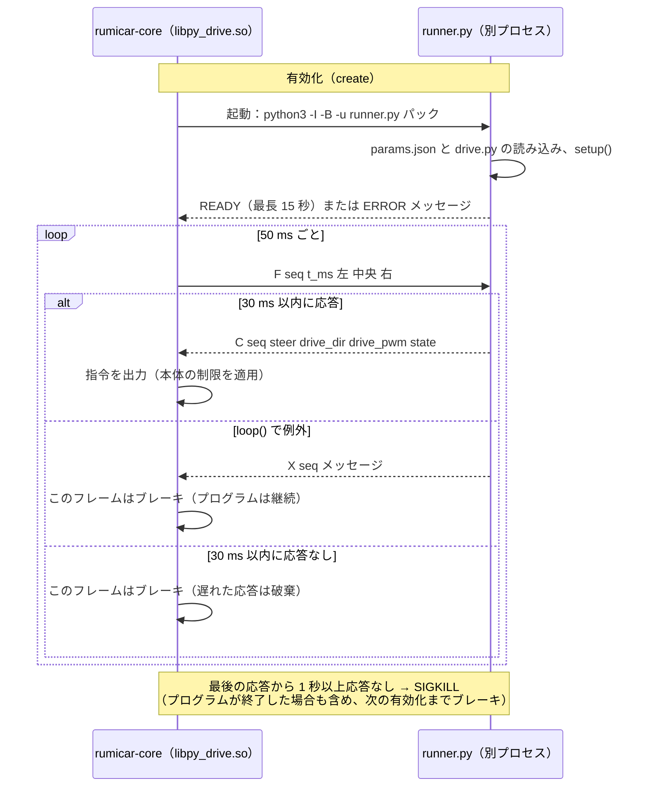

### 11.4 補足

- 送信されたパックは `/var/lib/rumicar/packs/<フォルダ名>-<日時>/` に格納され、`rumicar-activate pair py_drive-0.2.0 <パック>` で SSH からも切り替えられます（ロジックとデータは組で切り替えます）。
- ToF による走行（`tof_drive`）は C++ で記述されています。Python で作成した処理を正式な走行ロジックに移植する場合は、`car/logic/tof_drive/` を参考にしてください。
- 見本 `py-sample` は車にも同梱されているため、PC にリポジトリが無くても「版の管理」から `py-sample-0.2.0` を有効化して動作を確認できます。

## 12. 解説動画

動作の要点を 1 本 30〜45 秒の動画にしています（`docs/videos/`、1280×720、音声なし。クリックすると GitHub のページで再生されます）。数値はすべて本版のソースの既定値です。

| 動画 | 内容 | 日本語 | English |
|---|---|---|---|
| ToF センサーの読み取り値と表示 | 0〜200 mm・−3（範囲外）・−1（タイムアウト）の違いと、走行ロジック `tof_drive` での扱い（5 章の表、`RC_read()` の値） | [01-tof-readings-ja.mp4](docs/videos/01-tof-readings-ja.mp4) | [01-tof-readings-en.mp4](docs/videos/01-tof-readings-en.mp4) |
| 自動モードの発進制御（急発進の防止） | `auto_accel_pwm_per_s`（287/s）による許容値の増加と「自動の最大出力」（5 章） | [02-auto-start-ja.mp4](docs/videos/02-auto-start-ja.mp4) | [02-auto-start-en.mp4](docs/videos/02-auto-start-en.mp4) |
| 駐車車両の追い越し（`cam_drive` の車両の挙動） | FOLLOW → OVERTAKE_OUT → OVERTAKE_PASS → OVERTAKE_IN。左右の ToF は前方 65° 向きで、内側の ToF が車両を見失ってから `pass_clear_ms` で残りの車体が通過する（7.5） | [03-overtaking-ja.mp4](docs/videos/03-overtaking-ja.mp4) | [03-overtaking-en.mp4](docs/videos/03-overtaking-en.mp4) |

動画は `docs/videos/make_videos.py`（Pillow ＋ ffmpeg）で作成しています。ソースの既定値が変わったときは、スクリプトの定数と字幕を直して作り直します（`python3 docs/videos/make_videos.py <出力先> [--lang ja|en]`）。実車確認で変わる可能性のある値（`pass_clear_ms` など、仕様書 8.3）は、確認後に字幕を合わせます。

---

# 開発者向け

## 車載側のビルド（Raspberry Pi OS Lite 64bit / Debian 13）

```sh
sudo apt install build-essential cmake pkg-config libgpiod-dev nlohmann-json3-dev libssl-dev libturbojpeg0-dev libcamera-dev
cmake -S car -B build -DCMAKE_BUILD_TYPE=Release
cmake --build build --parallel
ctest --test-dir build --output-on-failure
sudo cmake --install build --prefix /usr/local   # 手動インストール
```

車へのインストールには Debian パッケージを使用します（CI の成果物 `rumicar-zero2cam-deb-arm64`、または `cmake -S car -B build -DCMAKE_INSTALL_PREFIX=/usr` で構成して `cd build && cpack -G DEB`）。`sudo apt install ./rumicar-zero2cam_<version>_arm64.deb` で本体・同梱ロジック／パック・systemd サービス・Wi-Fi AP（SSID `RumiCar`、10.42.0.1）のプロファイルがインストールされ、状態ディレクトリ `/var/lib/rumicar` が作成されます。

libcamera の無い環境では `-DRUMICAR_WITH_CAMERA=OFF` でビルドできます（その本体はカメラを起動せず ToF のみで走行します）。

走行ロジックは `car/logic/` にあります：`tof_drive`（ToF による走行）、`cam_drive`（`tof_drive` にカメラによる判断を追加したもの：`vision_features` 特徴量、`vision_pack` の `vision.bin`、`vision_eval` 検出器の評価と時間方向の確定、`cam_logic` 信号機・車両・交差点の挙動と優先順位）、`py_drive`（パックの `drive.py` を `runner.py` が別プロセスで実行し、`py_process` がフレームごとに 1 行で送受信。タイムアウト・異常終了時はブレーキ。`test_py_drive` が実際の runner で検証）。本体とロジックのインターフェースは `car/include/rumicar/logic_api.h`（ABI 2：補助出力 `aux` と `aux_name`）で定義しています。特徴量と `vision.bin` の Python 実装は `car/tools/rumicar_vision.py` で、`car/tests/data/vision` の黄金データ（`make_golden.py` で生成）を介して C++ 実装と完全に一致することを `test_vision` で検証しています。`car/tests/tools_smoke.py <build dir>` は合成した収録から学習し、`rumicar-replay` で停止・発進、追従と追い越し、交差点での停止までを一連で検証します（CI でも実行）。

## 制御ループと ToF 走行ロジック

本体は 50 ms ごとに図 10 の処理を行います。走行ロジック `tof_drive` の状態遷移は図 11 のとおりです（仕様書 3.5、3.7）。

**図 10** 制御ループ 1 フレーム（50 ms）の処理

<!-- figure: ja/10-frame.mmd -->
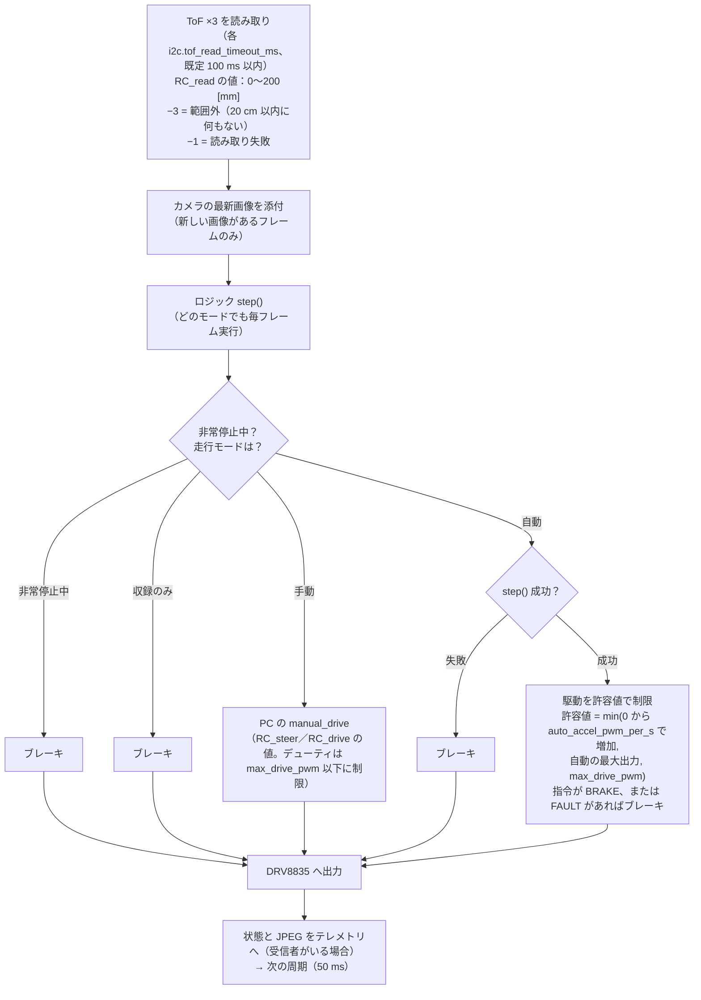

**図 11** tof_drive の状態遷移

<!-- figure: ja/11-tof-states.mmd -->
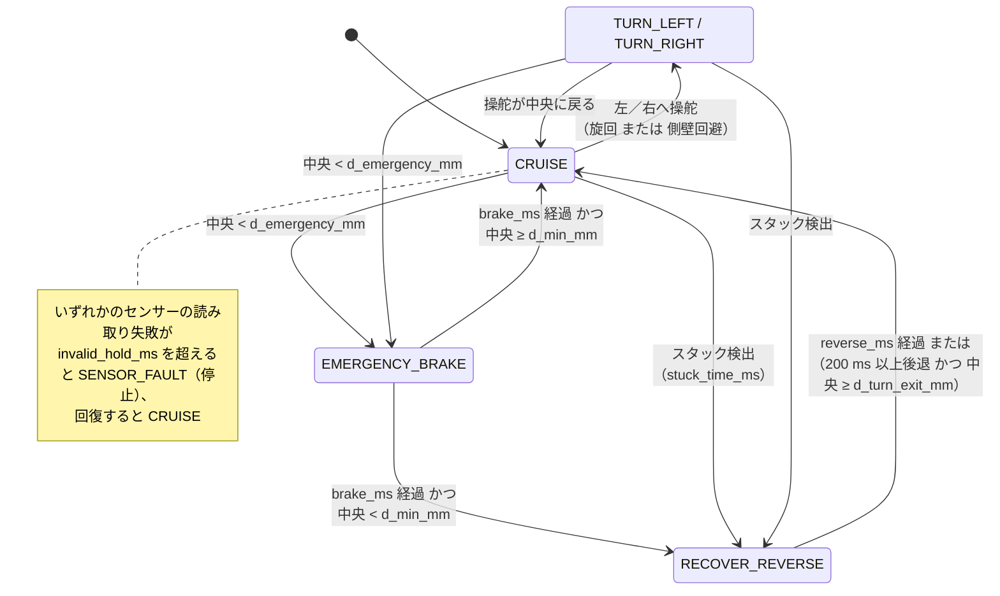

図のソースは `docs/figures/ja`（日本語）と `docs/figures/en`（英語）の `.mmd`（Mermaid）です。README の図はその写しで、ソースを変更したら `python3 docs/figures/sync_readme.py --write` で反映します（CI は `--check` で一致を検査します）。

## PC 側のビルド（Windows / .NET 10 SDK）

```sh
dotnet build pc/RumiCar.sln -c Release
dotnet test pc/RumiCar.Protocol.Tests -c Release
dotnet publish pc/RumiCar.DriveManager -c Release -r win-x64 --self-contained -p:PublishSingleFile=true
```

## SD カードイメージと Release

- イメージは `car/image/build-image.sh` で作成します（root、arm64 ホスト。公式の Raspberry Pi OS Lite 64bit に chroot でパッケージをインストールし、初回起動の設定を追加します）。CI では main への push とタグで `car.yml` の `image` ジョブが作成します。
- Release は、main の commit に `vX.Y.Z` のタグを付けて push する（または GitHub の Releases ページで新しいタグを指定して Release を作成する）と `release.yml` が実行され、イメージ・.deb・PC アプリ・`SHA256SUMS.txt` を添付します。
- 本体の版は、**次の Release の番号をソースに記述してからタグを付けます**。手順：(1) プルリクエストで `car/CMakeLists.txt` の `RUMICAR_VERSION`、`pc/RumiCar.DriveManager/RumiCar.DriveManager.csproj` の `<Version>`、`pc/RumiCar.DriveManager/app.manifest` の `assemblyIdentity version`（`X.Y.Z.0`）を同じ番号にする、(2) マージする、(3) そのマージの commit に `vX.Y.Z` のタグを付けて push する。`release.yml` は最初にタグとこの 3 か所の一致、およびタグが main の commit であることを検証し、不一致ならビルドせずに停止します（タグと内容の版が食い違った Release を作成しないため）。
- タグ以外のビルド（main・プルリクエスト）では、CI が版の後ろに `+g<commit>` を付けます（`car.yml` の `-DRUMICAR_VERSION_SUFFIX`、`pc.yml` の `-p:InformationalVersion`）。手元でのビルドはソースの番号のままです。ロジックの版（`TOF_DRIVE_VERSION`／`CAM_DRIVE_VERSION`／`PY_DRIVE_VERSION`）は本体の版とは独立に、ロジックを変更したときに上げます。ロジック・パックの内容（.so 以外のファイルや manifest の説明を含む）を変更したときも版を上げます（車は同じ版のディレクトリを上書きしないため。9.2）。

## 本版（0.4.1）の範囲

- 車：ToF 走行ロジック、制御ループと安全制御、走行モード（auto / manual / record_only、起動時は record_only）と非常停止、Camera Module 2 の取り込み（libcamera、RGB24 320×240・20 fps、必要なときのみ動作）と JPEG 送信、制御サーバー（TCP 5600）・テレメトリサーバー（TCP 5601）、Wi-Fi AP（NetworkManager、本体が順序制御して起動）と `set_wifi`、低電圧・処理速度制限の監視、ロジック／パックの走行中の差し替え（PC または SSH から）、manifest による検証と説明・対応機能・学習元の記載、systemd サービス、Debian パッケージ
- PC：制御・テレメトリ・manifest・収録の各形式と走行管理アプリ（接続、状態・画像、走行モード、非常停止、手動操作（操縦パッド・スクロール・キー）、自動の最大出力、PC の Wi-Fi の表示、シナリオ付き収録、版の管理（ロジックとデータの組での切り替え）、自作プログラムの送信、収録からの動画作成）
- 車：画像ロジック `cam_drive`（信号機での停止・発進、前方車両への追従と駐車車両の追い越し、交差点での停止・直進・右左折）、学習データ `vision.bin`、学習ツール `train_pack.py`、再生ツール `rumicar-replay`、ロジックのインターフェース ABI 3
- 車：自作の走行プログラム（Python の `drive.py`）を実行するロジック `py_drive` と見本 `py-sample`、自動モードの駆動許容値の増加制限と最大出力（`set_auto_limit`）、ロジックとデータの組での切り替え（`activate_pair`）
- 配布：標準 SD カードイメージ、タグによる GitHub Release（0.2.0：ロジックのインターフェースが ABI 1 から 2 に変わり、自作ロジックの再ビルドが必要なため 0.1.x から繰り上げ。0.2.1：手動操作を操縦パッドとスクロールに変更、タグとソースの版の一致を Release で検証、Release ではないビルドに `+g<commit>`。0.3.0：自作の走行プログラム、自動の最大出力と急発進の防止、PC の Wi-Fi の表示。0.3.1：文書・画面表示・メッセージの表記を技術的に正確な表現に統一（`py_drive` 0.1.1、`py-sample` 0.1.1、`cam-base` 0.1.1。動作の変更なし）。0.3.2：図の追加（README・仕様書、日本語・英語。動作の変更なし）。0.4.0：値の表し方を RumiCar ライブラリ（Arduino の RumiCar-lib、Raspberry Pi の RumiCar.py）に統一——ToF は `RC_read` の値（0〜200 mm、−1 タイムアウト、−3 範囲外＝20 cm 以内に何もない）、操舵は `RC_steer` の LEFT=0／CENTER=1／RIGHT=2、駆動は `RC_drive` の FREE／REVERSE／FORWARD／BRAKE と 0〜255。ロジックのインターフェースは ABI 3、制御の通信は protocol 2、`core.json` は `max_drive_pwm`／`auto_accel_pwm_per_s`／`kick_pwm`、`drive.py` は RumiCar ライブラリの API。0.3.x の PC アプリ・収録・自作ロジックとは互換性がなく、収録は取り直しが必要。0.4.1：SD カードの作成と本体の更新を走行管理アプリから——Release に Raspberry Pi Imager の一覧（`rumicar-zero2cam.rpi-imager-manifest`）を添付し、アプリの「SD カードを作る…」がイメージのダウンロードと検証を行って Imager を開く。最新の Release の確認。車側の動作の変更なし）
- 今後の作業：実車での収録と調整（追い越し・右左折の時間、交差点の画像の学習）、場面に応じた右左折の選択（現状は版ごとに固定、または検出した側へ）

## ライセンス

MIT License（[LICENSE](LICENSE)）
